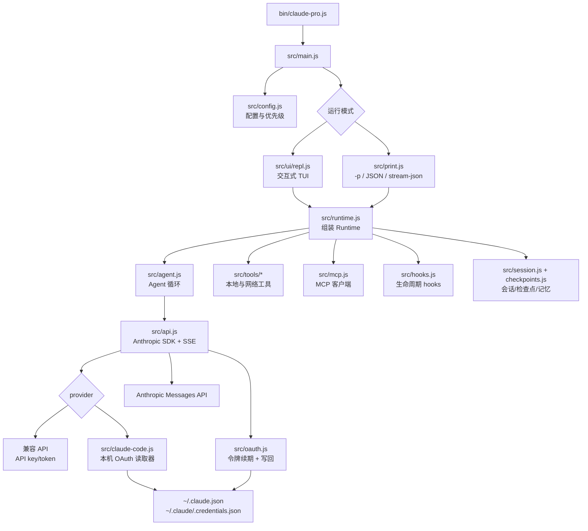
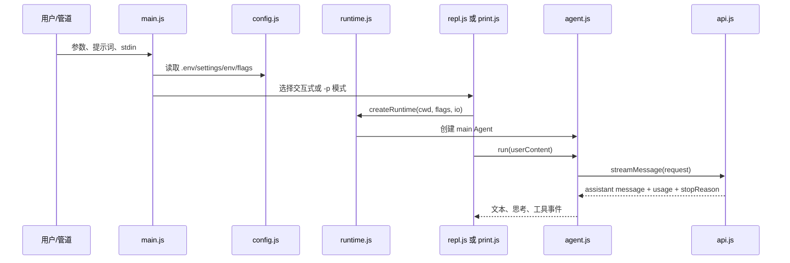
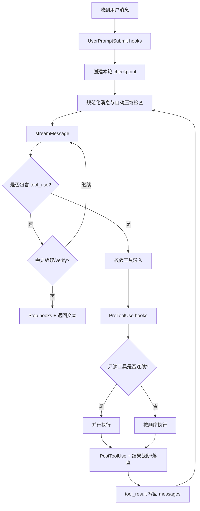

# copy-claude-code 架构说明

本文档说明当前项目的运行时架构、请求链路、工具执行模型、会话持久化方式，以及复用本机 Claude Code 登录态的实现边界。文档对应仓库当前实现；代码发生变化时，应同步更新本文档。

## 1. 项目定位

`copy-claude-code`（命令名 `claude-pro`）是一个 Node.js 编写的终端 Coding Agent。它自己实现 Agent 循环和工具系统，模型侧支持两种后端：

| 后端 | 用途 | 凭据来源 | 请求目标 |
|---|---|---|---|
| `api` | Anthropic 兼容 API，例如 Anthropic、DeepSeek 兼容接口 | `ANTHROPIC_AUTH_TOKEN` 或 `ANTHROPIC_API_KEY` | `ANTHROPIC_BASE_URL`，默认 `https://api.anthropic.com` |
| `claude-code` | 复用本机已有 Claude Code 订阅登录态 | 只读本机 Claude Code 元数据和 OAuth 凭据文件 | 固定 `https://api.anthropic.com` |

第二种模式不会在本项目中登录或复制凭据，也不会启动官方 `claude` CLI 子进程。项目读取已经存在的登录态，在访问令牌过期时用其中的刷新令牌续期并把新令牌写回同一个文件（唯一会写它的代码是 `src/oauth.js`，见 6.2），然后直接构造 Claude Code 风格的 Anthropic Messages HTTP 请求。

## 2. 总体架构



核心分层可以概括为：

1. `main` 负责命令行入口、参数解析和交互/非交互分流。
2. `runtime` 把配置、Agent、工具、MCP、hooks、任务和持久化组件组装起来。
3. `agent` 负责“发送上下文 → 接收流式模型响应 → 执行工具 → 回填结果 → 继续请求”的循环。
4. `api` 只负责模型请求、SSE 组装、重试和错误归一化；它不执行工具。
5. `tools`、`mcp`、`hooks` 和 `session` 提供 Agent 可调用的能力与状态管理。

## 3. 启动与请求生命周期

### 3.1 进程启动

入口文件是 [`bin/claude-pro.js`](bin/claude-pro.js)，它调用 [`src/main.js`](src/main.js) 的 `main()`：



### 3.1.1 监督进程与自重启

交互式会话（TTY、非 `-p`、非 `config`）由 [`bin/claude-pro.js`](bin/claude-pro.js) 交给 [`src/supervisor.js`](src/supervisor.js)：监督进程用 `stdio: 'inherit'` 把真正的程序作为子进程跑在同一个终端上（环境变量 `CLAUDE_PRO_SUPERVISED=1`、`CLAUDE_PRO_RESTART_FILE=<临时文件>`），子进程以退出码 **75** 结束就再启动一次（带 `CLAUDE_PRO_RESTARTED=1`），其他退出码原样透传；子进程在重启后 15 秒内崩溃会提示"刚加载的代码可能坏了"。监督进程不 import 任何项目代码，所以源码改坏也拖不垮它；它自己的代码（以及 bin）改了只有下次真正启动才生效。

重启流程（[`src/restart.js`](src/restart.js)、`App.requestRestart/restartNow`）：

1. 触发：`Restart` 工具（模型）、`/restart`（用户）、源码监视（`fs.watch` 递归监视 `src/` 和 `bin/`，去抖 400ms，回合结束/空闲时处理）。启动时记下每个 `.js`/`.json` 的内容摘要，事件来了只有内容真的变了（或文件新增、删除）才算：Windows 的 `fs.watch` 连"最后访问时间"更新也报（系统默认开启，读文件时最多每小时更新一次，例如另一个窗口启动、npm 打包），以前会触发无谓的重启。只有 npm 安装的副本（`installedByNpm()`）才把磁盘上更新的 `package.json` 版本当作"别的窗口装了新版本"；源码仓库里改版本号是在发版。
2. 先 `runSelfCheck()`：起一个临时进程 `claude-pro --self-check`（[`src/selfcheck.js`](src/selfcheck.js)）：import 所有入口模块，在假终端里启动真正的 `App`（建 runtime、画欢迎框和输入框）。它用 `selfCheck` 选项而不是测试用的 `noProcessExit`：除了不结束进程，启动路径和真实会话一样（全屏渲染、更新定时器、peers/上线/自动更新的判断都会走到），只用 `CLAUDE_PRO_PEERS=0`、`CLAUDE_PRO_ONLINE=0`、`CLAUDE_PRO_AUTO_UPDATE=0` 关掉对外的副作用；否则只在真实启动时才执行的代码出错，自检查不出来（0.5.2 后的一次重启就这样崩在 `CHECK_EVERY_MS` 未导入上）。然后检查每个工具名/描述/`input_schema`、系统提示词。不通过就不重启，错误返回给模型/用户。
3. 工具触发的重启推迟到**本回合结束**（那条 tool_result 和模型的收尾回复必须先写进会话，否则恢复后会有没有结果的 tool_use）。用户 Esc 打断则取消待定的重启。
4. `restartNow()` 把状态写进 `CLAUDE_PRO_RESTART_FILE`（会话 id/文件、`modelOverride`、`effortOverride`、模式、todos、草稿和光标、排队消息、检查点、最近的重启时间、给模型的提示）后以 75 退出；终端交接时不关原始模式、不关括号粘贴、不弹标题栈。
5. 新进程 `main()` 里 `takeRestartState()` 读取并删除状态文件，忽略命令行里的首个提示词和 `-c/-r`，用状态里的会话；`App.start` 不画欢迎框和历史（旧输出还在屏幕上），只打印一行 `↻ Restarted`，恢复草稿、待办、检查点（`CheckpointStore.adopt`），再把"已重启"提示和排队消息合成一个回合发出去。提示以 `[` 开头，不会被当成会话标题。

`Restart` 工具只在能重启的会话里才构建（子 agent 永远没有），系统提示词里也只有这时才有"你自己的源码"一节。`childEnv()` 会删掉这三个环境变量，Bash 工具启动的子进程不会误以为自己是可重启的会话。

### 3.1.2 远程控制

登录了网关的电脑上，每个交互会话都接在**网关**（`config.gatewayUrl`，默认 gw.predix.icu）的远程控制上，用户在网关用户端的"远程控制"菜单里看和操作它（只限同一账户）；没有开关命令（`/remote-control`、`/rc`、`--rc` 已去掉，`--rc` 仍被接受并忽略），`CLAUDE_PRO_ONLINE=0` 只给自检和测试用。和官方经 Anthropic 中转一样，会话只发出站请求、不监听端口；鉴权用 `/login` 存下的网关 API key（`readGatewayLogin`），与模型请求走哪个提供方无关。实现是 [`src/remote.js`](src/remote.js) 的 `RemoteControl`；网关那边的中转和页面在 codex-gateway 仓库。

- **上线与下线**（`App`，[`src/ui/repl.js`](src/ui/repl.js)）：`autoStartRemote` 在启动时（不阻塞）上线：`onlineWanted()`（登录了网关、`CLAUDE_PRO_ONLINE` 不是 0；测试驱动的 App 要显式 `CLAUDE_PRO_ONLINE=1`），或者有 `--remote-id`（网页经电脑服务打开的会话，见 3.1.5：用网关给的 id 立即上线，不看 `CLAUDE_PRO_ONLINE`），或者重启状态里带着 `remote.id`（沿用同一个 id）。`syncRemote()` 让在线状态跟上登录：`/login` 成功后立即调用（当前会话马上上线并打印链接，同时 `ensureHost()`），`/logout` 直接 `stopRemote()`，另外每 10 秒一次（别的窗口登录/退出、换账号：key 或网关地址变了就断开，没断开的重新连）。网关拒绝的 key 记在 `remoteRefused`，同一个 key 不再自动重试（只提示一次），换了登录才再试。`/status` 用 `remoteState()` 显示状态（在线/连接中/重试中/没登录/key 被拒），以及电脑服务的状态（`describeHost`）。

- **协议**（Bearer = 网关 API key）：
  - `POST /v1/remote/sessions {id, name, title, cwd, host, machine, peerId, model, version}` → `{id, url}`：注册。`id` 由客户端生成（`newRemoteId`，12 位 base64url；`--remote-id` 给定时用它），重启后沿用（`handoff()` 写进重启状态），`url` 是会话在网关用户端的页面（网页列表里用；终端不再显示它）。
  - `GET /v1/remote/sessions/:id/commands`（SSE）：连着就算在线。收到 `{type:'viewers',count}`（页面数，页脚显示）、`{type:'snapshot'}`（网关要完整快照）、`{cid,type:'send'|'interrupt'|'dialog'|'options'|'suggest'|'list',body}`（页面下发的命令，见下面"从页面下发"）。50 秒没有任何数据（网关每 15 秒 ping）视为断开；断开后 1s、2s、4s… 最长 30s 重连，404 表示网关忘了这个会话，先重新注册。
  - `POST …/results {cid, ok, …|error}`：命令的结果，网关拿它回复页面的请求（返回 `{ok, delivered}`）。处理函数可以返回 promise（`options` 要等网关的模型列表），结果在它完成后再发；网关最多等 15 秒。`close()` 先让出当前调用（页面发来的 `/cd`、`/exit` 在命令处理函数里就关闭会话，它的结果要等处理函数返回才发出），再等在路上的结果发完（最多 1.5 秒），然后才断开命令流、发 bye：网关在命令流断开时会让还没结果的命令失败。
  - 网关的错误是 `{type:"error", error:{type, message}}`；注册时一个账户已有 20 个在线会话返回 429，id 被别的账户占用返回 409。
  - `POST …/events {messages:[…]}`：按顺序的 `{t:'snapshot',seq,items,status}`、`{t:'batch',events}`、`{t:'status',status}`、`{t:'bye',restarting}`。网关只存"最新快照 + 之后的事件 + 最新状态"并转发给页面，不需要理解内容。
- **事件模型**：页面看到的是一串条目（`user`、`text`、`thinking`、`tool`、`output`、`summary`），由事件 `user/start/delta/stop/tool/progress/sub/done/output` 更新。归约函数 `applyEvent(state, ev)` 和 `hydrate(items)` 是自包含的，网关页面里有同一份拷贝（codex-gateway 的 `src/user-remote.js` 顶部，改事件语义时两边一起改）。页面渲染在网关那边，它的 CSP 不允许内联样式：ANSI 颜色等用 `data-*` 属性再由脚本设置。每个事件带递增 `seq`，快照带当时的 `seq`，页面丢弃不大于它的事件。
- **上传**：事件攒 150ms 一批，一次只有一个 POST 在路上（保证顺序）；运行中工具的输出（`toolProgress`）只在发送时取最后 8 行。需要快照的时候（刚连上、网关要求、`resync`、上一个 POST 失败、距上次快照超过 500 个事件、有人开始看）发快照代替事件：`snapshotItems` 取最近的条目（最多 400 个、序列化后不超过 1.5 MB，因为网关每个 POST 最多 2 MB、超出返回 413；过长的文本和输出截去中间），并且是**拷贝**（POST 可能排在前一个后面晚些才序列化，那时活的条目已经变了，快照 seq 之后的事件会被重复应用）；失败的 POST 不重发，下一份快照包含了丢掉的一切。没人看（`viewers === 0`）时不上传事件，只在列表用到的字段（忙/闲、标题、模型、目录、名字）变化时发状态，最多每 3 秒一次；有人看时每 500ms 比较一次状态，变了就发。状态由 `App.remoteStatus()` 计算（忙/动词/用时/token、限流倒计时、待办、排队、打开的对话框、模型、目录、标题）。
- **App 的接法**（[`src/ui/repl.js`](src/ui/repl.js)）：`Screen.log` 的每次调用都通过 `screen.onLog` 转成 `output` 事件（命令输出、提示、错误原样带 ANSI，页面转成 HTML）；已经用专门事件表达的打印（用户消息回显 `echoUser`、流式 Markdown、思考、工具头和结果、欢迎框、恢复会话时重印的历史）改走 `logLocal()`，它在打印期间把 `remoteMuted` 加一，不会重复。`streamEvent` 发 `start/delta/stop`，`toolStart` 发 `tool`，进度 `toolProgress`、子 agent 的工具 `sub`，结束/拒绝/中断时 `remoteToolDone()` 发一次 `done`（用 `renderToolResult` 按 100 列排版）。`/clear`（`newSession`）、`/resume`（`loadSession`）、`/rewind` 恢复对话时 `resync()`：按 `agent.messages` 重建条目（`transcriptItems`）并发新快照。新增会改变对话显示的地方时，要么发事件、要么 resync，并把对应的终端打印改成 `logLocal`。
- **从页面下发**：`remoteSend` 等同在输入框敲回车（`onSubmit`：忙时排队、`/命令`、`!`、`#`、`@会话` 都照常）；忙时的 `/命令`、有对话框打开时的普通消息直接拒绝（错误作为结果回给页面）。对话框通过 `remoteDialog()` 暴露（`SelectDialog` 的标题、问题、选项，按下标回答，因为选项值不一定是字符串；计划审批附带完整计划 `dialog.markdown`），`answerDialog` 校验 `id` 仍是当前对话框再 `resolve`。`remoteInterrupt` 等同 Ctrl+C 的第一下（取消对话框并中断）。
  - **send 带图片**：`body = {text, images?: [{media_type, data}]}`。`remoteImages()` 校验：最多 6 张；`image/png|jpeg|gif|webp`；base64（允许 `data:…,` 前缀和空白）；解码后不超过 5 MB；`imageSize()` 能读出尺寸（类型和内容对得上）。错误原文（英文，和其他结果一致）：`At most 6 images can be sent at a time (this message has N).`、`The image is image/bmp: only PNG, JPEG, GIF and WebP images can be sent.`、`Image 2 is not base64 data.`、`The image is 6.0 MB: at most 5 MB.`、`The image is not a readable JPEG image.`（一张时说 The image，多张时说 Image N）。之后和 alt+v 粘贴的图片一样走 `onSubmit(value, raw, images)`（忙时进队列，`startTurn` 里 `fitImagesIn` 缩到 1568 px、重 PNG 转 JPEG）。只有图片没有文字时，文字是 `[Image #1] [Image #2]…`，和终端输入框里只粘贴图片后回车发出的一样。
  - **只读查询**（忙时也回答，不在终端产生任何显示）：`options` → `remoteOptions()`：`{model: 当前模型 id, models, effort: 和 status.effort 一样, efforts, mode: 'full'|'plan'}`，`models`/`efforts` 来自 `modelChoices(cfg)`/`effortChoices(cfg)`（[`src/commands.js`](src/commands.js)，`/model`、`/effort` 的选择框也用它们），纯文本 `{value, label, description}`，`value` 是 `/model <value>`、`/effort <value>` 接受的值，第一个是 `default`；网关模型列表取不到时照 /model 降级（只列 gpt-6.1-sol）。`suggest {text, cursor}` → `remoteSuggest()`：调 `suggest(text, cursor, {quiet: true})`（和输入框同一份：`/命令`、`@文件`、`&会话`；`quiet` 时 `&` 没有结果也不 `flash`、不刷新输入框），去掉 ANSI，最多 50 项 `{value, label, description, submitOnEnter, noSpace}` 加 `from`/`to`，没有时 `{items: []}`；`&` 补全时网关会话列表超过 10 秒没更新就先刷新（最多等 3 秒）。`list {path}` → `remoteList()`：电脑服务的 `listDirectory()`（[`src/host.js`](src/host.js)，结果字段完全一样），只是 `path` 为空时列会话的工作目录。
  - 页面上改名字、目录、模型、effort 都是发斜杠命令（`/rename <名字>`、`/cd <目录>`、`/model <值>`、`/effort <值>`），和终端里输入一样：带参数时不弹选择框（`/model`、`/effort` 在缓存热时仍会弹 confirmCacheLoss，页面能回答）。
- **`/cd <目录>`**（`App.changeDirectory`）：绝对路径、`~`、`D:`，或相对当前目录的路径（`normalizeDir`，否则 `path.resolve(cwd, …)`）；不存在、不是目录、和当前目录相同时只打印一行，不重启；忙时拒绝；不在监督进程下（`canRestart()` 为假）时报错。否则走重启：`requestRestart({cwd})` → `restartNow` 先用 `moveSession()`（[`src/session.js`](src/session.js)）把会话文件写到新目录的项目目录（`projects/<新目录>/<同一个 id>.jsonl`，第一行 meta 的 `cwd` 换成新目录，`/resume` 在新目录能找到，`SessionStore(cwd, id)` 也接着往这里写），重启状态里带 `cwd` 和 `changedDirectory: true`，写成功后才删旧文件（写失败就删新文件、不重启）。新进程的 `main.js` 在取到重启状态后 `process.chdir(state.cwd)`（监督进程总是在第一次启动的目录里拉起子进程，所以之后每次重启的状态里都带 `cwd`），于是项目设置、CLAUDE.md、auto memory、系统提示词里的目录和 git 状态、`@` 文件索引、输入历史全部按新目录加载。保持不变的：对话、远程控制 id（`handoff()`）、模型/effort/模式、待办、排队的消息、草稿；`/rename` 或 `--name` 起的名字（`customTitle` 不为空）通过 `peerName` 带过去，按目录取的默认名字不带（新进程按新目录名取，网关注册时 `name`、`cwd` 都是新的）。`/cd` 不计入"5 分钟 5 次"的重启循环保护。新进程在 `resumeAfterRestart` 里打印 `Working directory: <目录>`（代替"↻ Restarted"），并把这一行放进 `seedOutput`，远程控制的初始条目（`seed()`）在对话后面带上它，所以页面重新拿到快照后也看得到；`/clear`、`/resume` 清空它。
- **退出与重启**：`close({restarting})` 把剩下的消息和 `{t:'bye',restarting}` 一起发出，进程等它最多 1.5 秒再退出。重启后的新进程用同一个 id 注册（`persistent`：网关暂时连不上也不放弃，后台重试），网关上的页面看到同一个会话回来并收到新快照。
- 测试：[`test/remote.test.js`](test/remote.test.js) 在无头终端里驱动真实 App（`CLAUDE_PRO_ONLINE=1`），假网关同时扮演中转和页面：登录了就自动上线、页面发命令跑一轮（工具调用和回答以事件到达）、在页面上回答 `AskUserQuestion`、忙时的命令和过期的对话框被拒绝、网关忘掉会话后自动重新注册并补发对话、`/clear` 重置、`/status` 显示状态（没有链接和二维码）、`/logout` 发 bye 下线、`/login` 立即重新上线、别的窗口退出登录后 `syncRemote` 下线；`--remote-id`/`--name` 用给定的 id 和名字上线（`CLAUDE_PRO_ONLINE=0` 也上线）；被拒绝的 key 只报一次、不再重试，换了登录才上线。

### 3.1.3 会话之间的消息（本机和其他电脑）

本机的会话经 [`src/peers.js`](src/peers.js) 的 `PeerNode` 互发（`CONFIG_DIR/peers/<id>.json` 登记、127.0.0.1 上的小 HTTP 服务）；同一网关账户下其他电脑上的会话经网关，复用远程控制那条连接（`RemoteControl`）：

- **在线**：登录了网关的电脑上，交互会话启动时连上网关（见 3.1.2 的"上线与下线"）。注册时带 `machine`（`machineName()`：`CLAUDE_PRO_MACHINE_NAME` 或主机名；电脑服务注册时用同一个值，网页据此把会话归到电脑下）和 `peerId`（本机 PeerNode 的 id，列表里据此去掉本机已经能直接联系的会话）。
- **列表**：`GET /v1/remote/sessions` → 同账户的会话（在线的在前）。`App.refreshRemotePeers()` 只留在线、未结束、不是自己、不在本机的，变成 `{id, name, machine, cwd, remote: true, label: 'machine/name'}` 存在 `remotePeers`；连上时、每 60 秒、输入 `&` 时（超过 10 秒没刷新）、发送时找不到名字时刷新。
- **寻址**：`resolvePeer(local, remote, ref)`：本机名字优先；然后 `machine/name`、只有一个远端会话叫这个名字、只有一个会话的电脑名、（模型发的才有）id 前缀；多个匹配时报歧义。用户输入的前缀是 `&`（`@` 只用于文件）：`suggest()` 在输入开头是 `&` 时给出本机和远端的会话（`peerSuggestions`），`sendTypedToPeer` 发送。
- **发送**：`POST /v1/remote/sessions/:目标/messages {from: 自己的 id, kind, text, inReplyTo}` → `{id, delivered}`（不重试：任务发两次会做两次）。网关按发送方的注册信息填 `from`，推到目标命令流：`{type:'peer', cid, kind, text, inReplyTo, from:{id, name, machine, host, cwd}}`。task 发给不在线的会话返回 409；reply 进目标的信箱（内存，24 小时，100 条 / 4 MB），目标重连时（viewers 之后）按顺序重推。
- **接收**：`RemoteControl.peerMessage` 按 `cid` 去重（重推的消息只确认），交给 `App.onPeerMessage`（`from.name` 是 `machine/name`，`from.remote = true`），然后用 `POST …/results {cid, ok: true}` 确认，确认后网关从信箱删除。之后的流程和本机消息相同：任务排队成一轮，`answerPeers` 在这一轮结束后把最终文本作为 reply 发回，远端的经网关（`remote.sendPeer`），本机的经 PeerNode。
- **文件**：`/sendfile`（`App.sendFiles`：解析 `&目标` 和路径，没加引号的带空格路径取能拼成已存在文件的最长连续词）和 MessagePeer 的 `files` 都走 `sendToPeer(target, text, {files})`，`filesToSend`（[`src/utils/downloads.js`](src/utils/downloads.js)）先检查：最多 20 个、每个 5 GB、不能是文件夹。远端：逐个 `remote.uploadFile`（[`src/transfer.js`](src/transfer.js)：先流式算 sha256，`POST /v1/remote/uploads {name, size, sha256}` 得到 `{id, received, chunkSize}`——网关对同一账户同 sha256 和 size 的未完成上传返回原来那个，所以再发一次同一个文件就是续传；然后按 `x-upload-offset` 一块块 `PUT`，每次只读一块进内存；409 带回网关实际的 `received`（一块传到一半断了时网关可能收下了一部分），404 重新开始，422 表示文件在发送中变了；网络类错误（无响应、超时、5xx、429、408）按 1、2、4…30 秒等待重试，自上次成功起最多 1 小时）得到 `{id, name, size, sha256}`，消息带 `files: [{id}]`，网关推送时按自己的元数据填 `files`；本机：消息里带 `{path, name, size}`（接收方只接受绝对路径）。接收方 `App.receiveFiles` 不管忙不忙立刻处理：远端的 `downloadFile` 流式写进下载文件夹里以文件 id 命名的 `.part`，断了用 `Range: bytes=N-` 接着下（60 秒收不到数据也算断），下完校验 sha256、`moveUnique`（`linkSync` 保证不覆盖同名文件）改成正式文件名，然后 `deleteFile`；本机的 `copyUnique`（`COPYFILE_EXCL`）。带文件的消息由 `RemoteControl.peerMessage` 等 `onPeerMessage` 返回的 promise 结束后才确认，所以接收方中途退出的话网关会在重连时重推，新进程从 `.part` 接着下。下载前用 `statfsSync` 检查剩余空间。发送和接收都在后台进行（`sendToPeer` 的 `background`，`/sendfile` 和 MessagePeer 都用），`startTransfer` 记在 `transfers` 里，页脚显示第一个的进度（`transferStatus`），`/sendfile stop` 中止发送；写进下载文件夹（`downloadsDir`：Windows 读注册表 Shell Folders 里的 Downloads，其他系统 ~/Downloads 或 xdg-user-dir；`CLAUDE_PRO_DOWNLOAD_DIR` 优先），同名时加「 (1)」，文件名经 `safeFileName` 清理（只取 basename、去掉非法字符和保留名）。只有文件没有文字的任务：立刻回复保存位置（`replyToPeer`），不跑模型，并给模型留一条 reminder；带文字的任务：把保存位置附在任务后面照常跑一轮。粘贴到 `/sendfile` 里的图片路径不转成图片附件。
- **`&` 补全**：`suggest()` 在光标前是 `(行首|空白)&词` 时都给出会话（`peerSuggestions`，替换范围是这个词），所以 `/sendfile a.jpg &公` 也能补全；全角 `＆` 同样处理。行首的 `&名字 任务` 直接发送；其他位置的 `&名字` 由 `peerMentions` 解析后作为 system-reminder 告诉模型是哪个会话、可以用 MessagePeer（含 files）联系它。附带的图片如果来自文件（`source`），把路径也告诉模型，模型才能把它当文件发出去。
- **名字**：`/rename`（`App.renameSession`）改本机 PeerNode 的名字（`setName` 在本机重名时加 -2），没有 PeerNode 时记在 `sessionName`；同时作为对话标题 `customTitle`（`sessionLabel()` 优先用它，`refreshTopic` 不再改标题），写进会话文件的 meta `name`（`/resume` 时恢复名字和标题）；再向网关注册一次（网关用注册时的 name 填 `from`），并推一次状态（网关列表用状态里的 name）。名字允许任何文字的字母（`cleanName` 用 `\p{L}\p{M}\p{N}`）。
- 测试：[`test/remote.test.js`](test/remote.test.js) 里假网关列出另一台电脑的会话：输入 `&` 弹出它、`&公司 …` 发任务、回答显示并被确认、那边发来的任务跑完后经网关回答、重推的任务只确认不再跑、`/rename` 重新注册新名字；`/sendfile` 上传文件（含不加引号的带空格路径）、`&` 在行中补全、收到的文件存进下载文件夹且不覆盖同名文件、只有文件时直接确认不跑模型；大文件：上传一块传到一半断开后按网关的 409 接着传、再发同一个文件接着未完成的上传、下载断开后用 Range 接着下且存好后才确认。

### 3.1.4 输入框的光标与回退菜单

- **可视行**：[`src/ui/editor.js`](src/ui/editor.js) 的 `layoutRows(body, textW)` 把文字按输入框宽度排成显示的行，每行带光标停靠点 `{i, col}`（每个下标恰好一个停靠点：折行处的字在下一行行首，换行符处是上一行行尾）。`render` 用它画输入框，`moveRow` 用它上下移动，所以自动折行的长行也能逐行移动；连续上下移动时 `goalCol` 记住起始列。第一行按上：文字不止一行且光标不在开头时先到开头，再按才 `historyPrev`；最后一行按下同理。`textW` 是上次绘制时的宽度。
- **双击 Esc**：输入框有文字时清空（`discard`，按上可找回）；为空时调用 `onDoubleEscape` → `App.openRewind()`（忙时 Esc 先中断，不会打开）。Node 的按键解析在 Esc 之后要等约 500ms 判断它是不是组合键的开头，连按的两个 Esc 常常合成一个带 `meta` 的 escape，两种都算连按。
- **回退菜单**（`/rewind`，[`src/commands.js`](src/commands.js)）：按时间列出检查点（最新的在最下、默认选中，`SelectDialog` 的 `selected`），`/clear` 前的对话（`app.previousSession`，在 `/clear` 里记下，`loadSession` 清掉）在最上面。动作：恢复代码和对话 / 对话 / 代码（`rewind()`）、Summarize from here / up to here（`Agent.summarizePart(index, {part: 'after'|'before'})`：整段对话加上 `partialCompactPrompt` 作为一次摘要请求，走 `requestSummary` 以复用缓存；被总结的部分换成一条 `partialSummaryMessage`，其余逐字保留；然后 `CheckpointStore.summarized` 让被总结的回合不能再回退对话、把之后的回合的 `messageIndex` 前移）、Never mind（回到列表）。回填输入框的是 `promptAt(agent, entry)`：检查点所在的那条用户消息的完整文字（标签只存前 200 字）。

### 3.1.5 电脑服务（claude-pro host）：网页的执行者

网关"远程控制"页是操作界面：按电脑（`computerId`）分组列出会话，在某台电脑的某个目录里新建会话（默认是没有窗口的后台会话，勾选后才开终端窗口），结束、重启会话，恢复历史对话，看日志和电脑状态，更新 claude-pro。每台电脑（每个 `CONFIG_DIR`）常驻一个后台进程执行这些，[`src/host.js`](src/host.js)；会话一启动就用网关给的 id 上线，网页直接接上。它和会话一样只发出站请求，鉴权用 gateway.json 的 API key（`/login` 或 `claude-pro connect` 存下）。下面先是最初的协议（列目录、开终端窗口），后台会话和其他命令见"后台会话"和"接入与自动启动"两小节。

- **协议**（Bearer = 网关 API key；host 的 id 规则同会话 id）：
  - `POST /v1/remote/hosts {id, machine, host, platform, version, home, terminal}` → `{id, ok}`。`id` 第一次生成后存在 `host.json` 里一直沿用；`machine` 是 `machineName(config.env)`，和会话注册时完全一样（网页按它分组）；`terminal` 是给人看的终端名（`Windows Terminal`、`Windows console`、`Terminal.app`、`gnome-terminal`、`tmux`…，打不开终端时为空）。注册返回 404 说明网关还不支持电脑（老网关），记一次日志、5 分钟后再试。
  - `GET /v1/remote/hosts/:id/commands`（SSE）：连着就算在线。帧和会话的命令流一样，50 秒没有数据视为断开；断开后 1、2、4…30 秒重连，404 表示网关忘了这台电脑（重启了），先重新注册。401/403：key 被拒，记下，10 分钟内不再用这个 key 重试（换了登录立即重试）。
  - `POST /v1/remote/hosts/:id/results {cid, ok: true, …} | {cid, ok: false, error}`：结果；错误是给用户看的中文（"目录不存在：…"、"不是目录：…"、"没有权限读取：…"、"无法用 Windows Terminal 打开终端：…"）。
  - `DELETE /v1/remote/hosts/:id`：从网页列表移除。`claude-pro host stop` 在进程结束后调用；登录变了（`/logout`、换账号）时服务用旧 key 调用。普通断线不调。
- **list `{path}`**：`listDirectory`。`""`/`~` 是 home；Windows 上 `D:` 是盘根、正斜杠也可以（`normalizeDir`，盘符大写）；不是绝对路径就报错。只列目录（指向目录的符号链接/junction 也算，但打不开的跳过；Windows 在 home 里指向 AppData 的兼容 junction，如 "Application Data"、各语言的「开始」菜单，也跳过，和资源管理器一样）；按名字不分大小写、数字按数值排序，`.` 开头的排后面；最多 1000 个（`truncated`）。`roots`：Windows 上存在的盘符（每个最多等 1.5 秒，缓存 30 秒），其他系统 `["/"]`。`recent`：`recentDirectories()`，每个项目目录读最新会话文件的第一行（`{type:'meta', cwd}`），新的在前，只留还存在的，最多 15 个，缓存 30 秒。
- **open `{sessionId, cwd, create, name}`**：校验 id 和绝对路径；目录不存在时 `create` 才递归创建；`name` 经 `cleanName`。用 `terminalFor()` 选终端、`launchCommand()` 拼命令、`runLaunch()` 执行，命令行是 `process.execPath` + 本仓库的 `bin/claude-pro.js` + `--remote-id <id> [--name <name>]`（源码运行和 npm 安装都对）：
  - Windows Terminal（`wt.exe` 是"应用执行别名"，`existsSync` 看不见，`findCommand` 用 `lstat`）：`wt -w new -d <cwd> node [--env-file=…] bin …`，每个参数里的 `;` 转成 `\;`（wt 的命令分隔符）。wt 新开的窗口用 Windows Terminal 自己的环境变量，不继承调用者的，所以服务把自己环境里的 `CLAUDE_PRO_*`、`ANTHROPIC_*`、`CLAUDE_CODE_*`、`CLAUDE_CONFIG_DIR`（`passedEnv()`：不含 TOKEN/KEY/SECRET/PASSWORD/HEADERS 和监督进程的变量）写进 `CONFIG_DIR/launch/<id>.env`，用 `node --env-file` 带过去（值用单引号或反引号，Node 的 dotenv 解析不转义里面的反斜杠；双引号会把 `C:\Users\nick` 里的 `\n` 变成换行）。这些文件 10 分钟后在下次打开时删除。
  - 没有 wt：PowerShell `Start-Process`（新控制台窗口；若系统默认终端是 Windows Terminal 就在它里面）。参数用 `quoteWindowsArg` 按 C 运行库规则拼成一个字符串，经环境变量交给脚本；PowerShell 本身隐藏、**不能 detached**（没有控制台的 PowerShell 直接以 0 退出、什么都不做）；出错时脚本只把 `$_.Exception.Message` 以 UTF-8 写到 stdout（否则是系统代码页的 CLIXML）。
  - macOS：`osascript` 让 Terminal.app `do script "cd '<cwd>' && exec env K=V … 'node' 'bin' …"`（单引号转义后再按 AppleScript 字符串转义）。
  - Linux 有 `DISPLAY`/`WAYLAND_DISPLAY`：`x-terminal-emulator`/`gnome-terminal`/`konsole`/`xterm` 里第一个有的，经 `sh -c 'cd "$0" && exec "$@"'` 进入目录；没有桌面时 `tmux new-session -d -s claude-pro-<id> -c <cwd>`；都没有就报错。环境变量用 `env K=V` 前缀带过去。
  - `runLaunch`：会退出的命令（wt、PowerShell、osascript、tmux）等它退出，非 0 时把最后一行输出作为错误；终端本身（Linux 桌面）只等 1.5 秒看它有没有立刻失败，并且不接管它的输出（关掉的管道会让它写 stderr 时收到 SIGPIPE）。
- **生命周期**：`claude-pro host`（= `host run`，前台，日志打到终端，Ctrl+C 停）；`host start` 以 detached、`windowsHide` 方式起 `host run --background`（日志写 `CONFIG_DIR/host.log`，超过 1 MB 轮换成 `host.log.1`），等它的心跳出现再返回；`host stop` 结束进程、写 `disabled: true`、调用 DELETE；`host status`；`host install`/`uninstall`（开机/登录后执行 `host start`：Windows 在启动文件夹写一个 UTF-16 的 `.vbs`，窗口样式 0；macOS LaunchAgent（`AbandonProcessGroup`）；Linux 有桌面时写 XDG autostart，否则写 systemd 用户服务（`Type=oneshot` + `RemainAfterExit`，所以后台进程留在服务的 cgroup 里不被杀））。`CLAUDE_PRO_CONFIG_DIR` 不是默认值时，这些文件名带它的哈希，并把它带进启动环境。
  - **只跑一个**：`host.lock`（`wx` 创建，内容是 pid）。锁的进程不在了，或者锁旧了而 `host.json` 的心跳（每 20 秒）也超过 90 秒，就接管（pid 可能已被别的程序复用）。`hostRunning()` = pid 活着且心跳不超过 90 秒。
  - **会话拉起**：`App.ensureHost()`（启动 3 秒后、`/login` 成功后）：登录了网关、`CLAUDE_PRO_ONLINE`/`CLAUDE_PRO_HOST` 不是 0、不是测试驱动的 App、不是自检、没有 `NODE_TEST_CONTEXT` 时，调用 `ensureHost()`：没在运行、没被 `host stop` 停掉、30 秒内没人刚拉起过（`spawnedAt`，防两个会话同时启动时各拉一个；真重了也只有一个拿到锁）就 `startHostInBackground()`。拉起时去掉监督进程的三个环境变量，否则服务打开的会话会以为自己已经在监督进程下，不能重启。
  - **跟随登录**：每 5 秒 `checkLogin()` 读 gateway.json（按配置的网关地址）；没了就用旧 key DELETE 并等待；换了 key 或地址就用旧 key DELETE、用新 key 重新注册。
  - **换成新版本**：每 60 秒算一次 `codeFingerprint()`（`bin/`、`src/` 下 .js/.json 的名字、大小、修改时间，加 package.json）；后台运行的服务发现变了并且下一次检查仍是同一个值（文件写完了）、没有命令在处理时停下当前的 `HostService`，`runHost` 先在单独的进程里跑 `claude-pro host check`（加载 background.js、ui/repl.js、main.js）：失败就在日志里写"the new version does not start, this one goes on"和错误末尾，开一个新的 `HostService` 接着跑（锁一直在手里，这台电脑不会掉线）；成功才释放锁、`startHostInBackground()`，最多等 30 秒看到新进程的心跳再退出，没等到就重新拿锁接着跑。后台会话在整个过程中不受影响（各自独立的进程），新服务按 host-sessions.json 接管。前台运行的只在日志里提示一次。`CLAUDE_PRO_HOST_TICK_MS`（测试用）把心跳和这个检查改成更短的间隔。
  - **日志**：前台、后台都写 `host.log`（前台同时打到终端），`logs {}` 返回它的末尾。

#### 后台会话（[`src/background.js`](src/background.js)）与网页的管理命令

- **无界面会话**：`claude-pro --headless --remote-id <id> [--name N] [--resume <conversationId>] [--model M]`。`main.js` 不看 TTY 直接进 `runRepl`；`runRepl` 给 `App` 一个 `VirtualTerminal`（[`src/ui/vterm.js`](src/ui/vterm.js)：`output` 代替 stdout，有 `columns/rows/isTTY` 和 `'resize'`，写到所有 attach 的客户端，没人 attach 时丢掉；`input` 是 PassThrough，代替 stdin）。和终端会话同一套 App：总是全屏渲染器、不查询光标、没登录网关时不弹浏览器登录、`screen.onLog` 另外把打印的内容去掉 ANSI 加时间写到 process.stdout（服务给它的日志文件）。`supervisor.js` 对 `--headless` 也做监督（不要求 TTY），子进程 `windowsHide`（父进程没有控制台，不加会给子进程弹一个窗口），异常退出时不写终端复位序列。`Ctrl+C` 两次/`Ctrl+D` 在后台会话里只提示（`keyboardExit`），`/exit` 才结束；结束（退出码 0、不是重启）时写 `CONFIG_DIR/background-ended/<id>` 标记。`--resume` 找不到对话时后台会话开新对话（从没发过消息的会话没有会话文件）。
- **会话注册表**（[`src/peers.js`](src/peers.js)）：每个会话的 `peers/<id>.json` 多了 `kind`、`remoteId`、`conversationId`（`info()`，连上网关、`/clear`、`/resume` 时 `update()` 重写，先写临时文件再改名）。本地 HTTP 服务多了 `POST /control {action: exit|restart|interrupt}`（`App.onControl`：exit 先取消对话框、中断，再 `exit(0)`；restart 是 `requestRestart({force})`）和 `GET /attach` 的 upgrade（`App.attachClient`）。
- **服务管理后台会话**（`BackgroundSessions`）：`open` 用 `process.execPath bin/claude-pro.js --headless …` 起 supervisor（detached、windowsHide、cwd=目录、stdout/stderr=`logs/sessions/<id>.log` 的 fd，追加模式）；只盯 supervisor：子进程 `exit` 事件（接管来的没有子进程句柄，每 2 秒看 pid）。退出码 0、有结束标记、或是 stop 发起的 → `exited`，移出恢复列表，进 `ended`（保留 20 个）；否则是崩溃：10 分钟内第 1–3 次 1 秒后用 `--resume <conversationId>` 重新拉起（`restarts` 加一，状态 `restarting`），第 4 次 → `failed`，`error` 是日志最后 12 行。每 2 秒 `tick()` 从注册表按 `remoteId` 同步 `cwd`（/cd 之后）、`name`、`conversationId`，出现了就从 `starting`/`restarting` 变 `running`（30 秒还没出现但进程活着也算 running）。`stop`：注册表里找到会话就 `POST /control exit`，10 秒不退 `killTree`（Windows `taskkill /T /F`，其他系统杀进程组）。`restart`：在跑的发 `/control restart`，状态 `restarting` 直到会话进程换了；`failed`/已结束的用 `--resume` 重新拉起，计数清零。日志每分钟检查一次，超过 1 MB 复制成 `.log.1` 再截断（进程以追加方式写，截断后接着写在开头）。
- **恢复**：`host-sessions.json` 存 `[{sessionId, cwd, name, conversationId, model, pid, startedAt, state?, error?, suspended?}]`，每次变化时写。服务启动（开机、换版本）时先用 `liveSessionProcesses()` 读一次系统的进程表（Windows 用 PowerShell 的 `Win32_Process` 查命令行，约 0.7 秒；Linux 读 `/proc`；macOS `ps`），按命令行里的 `--headless --remote-id <id>` 找出每个后台会话正在运行的 supervisor 和会话进程（父进程不在其中的是 supervisor）。有就接管（`adopt()`：多个 supervisor 时留下文件里记的那个，其余连同子进程结束并写日志"ran twice"；只剩会话进程、它的 supervisor 被杀了的，就盯着会话进程本身，它退出后按崩溃处理）；没有才用 `--resume` 重新打开（第一次启动时才带 `--name`/`--model`）。之后每次以 `--resume` 拉起（崩溃、重启 failed 的、登录恢复）之前也先这样查一遍，所以同一个 remote id 不会有两份。`failed` 的不自动打开；用 stop 或 `/exit` 结束的已经不在文件里。服务停止（`close()`）后崩溃的会话不再拉起。（0.7.1 及之前按"开机时间 + 文件里的 pid"判断，接管时没把开机时间写回文件，下一个服务就当它不在了又开一份：一个会话被开成了 5 份。）
- **休眠**：退出登录，或者网关拒绝密钥（401/403：网页移除了电脑、密钥作废，日志写一次"这台电脑已从网页上移除"），`suspendAll()` 结束所有后台会话但留在恢复列表里（`suspended`）；gateway.json 再变成可用的登录（`/login`、`connect`）时 `resumeAll()` 用 `--resume` 打开它们。
- **注册与状态**：`POST /v1/remote/hosts` 带 `autostart`（`'boot'|'logon'|''`）、`sessions`、`stats`；`POST /v1/remote/hosts/:id/state {sessions, stats}` 在会话变化后 300 ms 内（合并）和每 60 秒发一次，404 时重新注册。`Stats`：CPU 每 5 秒采样 `os.cpus()`，按最近一分钟的空闲比例算；内存 `totalmem - freemem`；磁盘 `fs.statfsSync(home)`；`os.uptime()`。
- **服务的其他命令**：`open`（`window:false` 开后台会话；`resume` 已在本机某个会话里打开时回 `{existing: 它的 remoteId}`，那个会话没连网关时报错；`model`）、`stop`、`restart`、`logs {sessionId?, lines}`（最多 2000 行，不给 id 时是 host.log）、`history`（[`src/history.js`](src/history.js)：扫描 `projects/*/*.jsonl`，按修改时间从新到旧，`title` = /rename 名字 > 话题 > 第一句话，消息条数在 reset 后重算；按 query/cwd/before 过滤；摘要按文件的 mtime+size 缓存，消息行只计数不解析；`sessionId` 来自注册表）、`update`（`checkForUpdate({force})`，有新版本时安装在后台进行，先回"正在安装"）。
  - `window {sessionId}`：把在跑的后台会话叫到前台：选终端和 `open` 的 `window: true` 一样（`terminalFor()`/`launchCommand()`），工作目录是会话当前的 cwd（不在了就 home），里面跑 `claude-pro attach <id> --keep-open`（Windows Terminal 加 `--title "<名字> · claude-pro"`；每次一个新窗口，env 文件和 tmux 会话名带时间戳）。会话进程不变，正在跑的一轮不受影响：attach 连上时会话发全屏序列、清掉已发的标题（下一次绘制重发给新窗口）并 `repaint()`，窗口里是当前画面（往上滚能看到全部对话）和之后的实时输出。关窗口（包括点 X：attach 进程被结束，连接直接断开）只是断开。`--keep-open`：attach 出错或会话结束时等按一个键再退出，否则窗口一闪就关。报错：不是这个服务的后台会话、会话没在运行（已结束的、failed、starting）、没有能开窗口的终端（提示在终端里 `claude-pro attach <名字>`）、终端打不开。没有桌面但有 tmux 时开 tmux 会话，回 `terminal: "tmux"`。
  - `delete {conversationId, stop}`：先校验 id（`CONVERSATION_ID`：8–64 位字母数字 `-` `_`，不合法直接报"对话 id 不对"，不会拼进路径）。注册表里开着这段对话的：终端会话 → 报错让用户自己 `/exit`；这个服务的后台会话 → 没有 `stop` 报错，有就先 `stop`（和 stop 命令一样）；别的后台会话 → 报错。然后 `forgetConversation()` 从 host-sessions.json 和已结束列表里去掉带这段对话的记录并收集它们的日志，`deleteConversation()`（history.js）删：所有项目目录里的 `<id>.jsonl`（/cd 会搬家），它引用的 tool-results（按工具调用 id 命名的 `<id>.txt`，和文本里出现的 `bash-<时间>-<随机>.txt`，在所有项目目录里找），检查点（`checkpoints/*/index.json` 里 `conversation` 是它的条目：删快照文件、重写 index；整个 run 只有它就删目录），以及那些后台会话的日志（含 `.1`）。项目级的 memory、CLAUDE.md、`history.jsonl`、其他对话的检查点不动。回 `{files, bytes}`；会话文件删不掉时报错。检查点条目从 0.7.2 起才带 `conversation`（`Agent.run` 的 `beginTurn` 写入），更早的检查点认不出属于哪段对话，留着等 14 天的自动清理。
- **attach 计数**：会话在注册表里写 `attached`（`vterm.clients.size`，attach 连上、断开时 `peers.update()`），服务每 2 秒同步进 `rec.attached`，变化即上报 state（`sessions[].attached`）。HTTP 服务器的 socket 默认 `allowHalfOpen`：对方关掉连接后不会自己 close，要在 `'end'` 时 `destroy()`，否则关掉的窗口要等写失败（约一分钟）才算断开。
- **会话一侧**：注册带 `computerId`（`host.json` 的 id，`computerId()`，没有时生成并保存）、`kind`、`conversationId`；status 加 `asking`、`cost`、`context {used, window}`（和 /context 一样，请求前的估算按消息数缓存）、`background`（后台 agent 和 shell）、`kind`、`conversationId`。没人看页面时 status 只在 busy/asking 变化时立即发（`urgentKey`），其余最多 3 秒一次。`output {id}`：工具结果全文（最多 1 MB），结果太长或被清理时读 tool-results 里保存的文件（只读 `projects/*/tool-results/` 下的）；还在运行的返回已有输出。对话框 `TextDialog`（[`src/ui/dialogs.js`](src/ui/dialogs.js)）：需要输入文字的问题，`status.dialog.input = {placeholder, value, multiline}`，网页用 `dialog {id, text}` 回答。bash 模式（`!命令`）的消息在网页初始条目和终端 `--resume` 时显示成运行时的样子（`bashModeLines`）。
- **attach**（[`src/attach.js`](src/attach.js)）：从注册表找 `kind: 'background'` 的会话（名字、remoteId 或注册表 id 前缀；不给时列出来选），`GET /attach?cols&rows` 带 token 升级连接；下行是屏幕原样，上行是 JSON 行 `{keys: base64}` / `{resize: [c, r]}`。会话收到连接时发全屏模式序列并 `repaint()`；终端尺寸取最后 attach 或改尺寸的那个。`Ctrl+]` 断开并复位终端；连接断了（会话重启）就等注册表里同一个 id 换了 pid 再接上，20 秒内没回来算结束。注意 HTTP 服务器的 upgrade socket 不允许 `setEncoding`，并且要 `resume()`。

#### 接入与自动启动

- **`claude-pro connect <code> [--url U]`**（[`src/connect.js`](src/connect.js)）：配对码规范化（大写，去掉空格和 `-`，8 位 `[A-Z2-9]`），`POST {url}/v1/remote/pair {code, id, machine, host, platform, version, home}`（不带认证）。成功后 `saveGatewayLogin`；网关地址和配置的不同时写进用户设置的 `CLAUDE_PRO_GATEWAY_URL`（会话和服务按配置的地址读 gateway.json）；网关给的 computerId 不同时改 host.json 的 id；清掉 `disabled`/`autostartDeclined`，`ensureAutostart({force})`，没在运行就启动服务（在运行的 5 秒内发现新登录）。400/429 原样或"请求太频繁"报错。
- **自动启动**：`ensureAutostart()`：`CLAUDE_PRO_HOST` 不是 0、用户没 `host uninstall` 过（`autostartDeclined`）时设置登录后启动；只自动做一次（`autostartAuto`），`/login` 和 connect（`force`）会再做。会话里由 `App.ensureHost()` 调用（启动 3 秒后；`/login` 成功后带 `login: true`，并提示一行）。`host install --at-boot`：Windows 用 `schtasks /Create /XML`（`BootTrigger`、当前用户、`LogonType S4U`、`ExecutionTimeLimit PT0S`、失败 1 分钟后重试 3 次、隐藏；动作直接是 `host run --background`，自定义配置目录时经 `cmd /c set …&&`），普通用户会被拒绝，提示用管理员终端；Linux 写 systemd 用户服务并 `loginctl enable-linger`，失败时提示 `sudo loginctl enable-linger`；macOS 说明做不到并设置登录后启动。`autostartKind()` 报 `boot`（计划任务存在 / unit 存在且 linger 开着，结果缓存 60 秒）、`logon` 或空。`host uninstall` 删除两者并记 `autostartDeclined`。
- 测试：[`test/host.test.js`](test/host.test.js)：假网关下注册的字段、list（只列目录含 junction、排序、点开头在后、parent/sep/roots/recent、各种错误）、open（不存在且没 `create` 报错、`create` 创建、wt 命令行里的 id 和名字、坏 id、不是目录、终端打不开时的错误）、网关忘了它后重新注册、换账号时旧 key DELETE 新 key 注册、退出登录时 DELETE 并不再注册、被拒的 key 不反复重试、文件变了后台服务重启、老网关（注册 404）5 分钟后再试；各平台的启动命令；路径规范化、Windows 参数引号、传递的环境变量；真实进程：第二个 `host run` 拿不到锁、`status`、`stop`（之后 `disabled`、会话不再拉起）、`start` 后台运行写日志再 `stop`。Windows 上另外手动验证过：经服务真的打开 Windows Terminal（目录名带空格和 `;`），里面的会话 0.6 秒内用给定 id 和名字注册、经网页命令 `/exit` 后窗口关闭；没有 wt 时的 PowerShell 窗口；`host install` 写的 .vbs 由 `wscript` 运行时隐藏启动服务。

### 3.2 交互式与非交互式

- 交互式终端进入 [`src/ui/repl.js`](src/ui/repl.js)，负责输入编辑、Markdown 渲染、流式输出、快捷命令和中断。
- `-p/--print` 或检测到非 TTY 时进入 [`src/print.js`](src/print.js)。可输出 `text`、`json` 或 `stream-json`，适合脚本和管道。
- `/continue`、`--continue`、`--resume` 使用 [`src/session.js`](src/session.js) 查找并加载当前项目的 JSONL 会话。
- `config list/set/unset` 在 `main.js` 中直接处理，不启动 Agent。

## 4. Runtime 组装

[`src/runtime.js`](src/runtime.js) 是依赖装配中心。`createRuntime()` 按以下顺序工作：

1. 调用 `loadConfig({ cwd, flags })` 得到有效配置。
2. 清理过期的大工具结果和旧检查点。
3. 创建 `ModeManager`、`CheckpointStore`、`HookRunner`、`BackgroundTasks`。
4. 加载内置/自定义 Agent 和 Skills。
5. 启动 `.mcp.json` 或 settings 中声明的 MCP servers。
6. 根据配置查找 Bash shell。
7. 调用 `buildTools()` 生成主 Agent 工具集合。
8. 生成主 Agent system prompt，并按需加载项目自动记忆。
9. 创建主 Agent，并注册后台子 Agent 完成通知。

运行时对象的主要字段如下：

| 字段 | 作用 |
|---|---|
| `config` | 有效配置、模型解析、上下文窗口和限制 |
| `checkpoints` | 文件编辑前快照和 `/rewind` |
| `agents` / `skills` | Agent 定义和 Skill 定义 |
| `mcp` | MCP server 连接与动态工具 |
| `shell` | Bash/Windows shell 执行适配 |
| `hooks` | `UserPromptSubmit`、`PreToolUse`、`PostToolUse`、`Stop` |
| `tasks` | 前台/后台子 Agent 任务表 |
| `tools` | 主 Agent 最终可见工具列表 |
| `systemPrompt` | 延迟构建、可失效重建的系统提示词 |
| `agent` | 深度为 0 的主 Agent |

子 Agent 使用同一个配置、模式、检查点和 hooks，但拥有自己的消息上下文、IO 和深度。`toolsForSubagent()` 会按 Agent 定义过滤工具，并使用 `maxSubagentDepth`（2）。

## 5. 配置体系与 provider 选择

### 5.1 配置优先级

[`src/config.js`](src/config.js) 从低到高合并以下来源：

1. 内置默认值。
2. 安装目录下的 `.env`。
3. `~/.claude-pro/settings.json` 的 `env` 块。
4. 当前项目 `.claude-pro/settings.json` 的 `env` 块。
5. 当前项目 `.claude-pro/settings.local.json` 的 `env` 块。
6. 进程环境变量。
7. 命令行 flags，例如 `--provider`、`--model`、`--effort`。

另外，`/model`、`/effort` 的选择按 provider 记在 `~/.claude-pro/settings.json` 的 `remembered` 块（`rememberChoice`），`createRuntime()` 用 `applyRememberedChoices()` 把它设为本次会话的 `modelOverride`/`effortOverride`：它压过 1–6，但命令行 `--model`/`--effort` 存在时不应用（flag 只管当次）。`/model default`、`/effort default` 删掉它。自重启交接的 override 也会写回这里。`updateSettingsFile()` 遇到不是合法 JSON 的设置文件会报错，不会用空对象覆盖它。

因此，`.env` 没有 `CLAUDE_PRO_PROVIDER` 时，代码默认使用 `api`。只有更高优先级来源设置了 `CLAUDE_PRO_PROVIDER=claude-code`，最终 provider 才会是 `claude-code`。可用下面的命令查看最终值和来源：

```powershell
node bin/claude-pro.js config list
```

临时切换：

```powershell
node bin/claude-pro.js --provider claude-code
node bin/claude-pro.js --provider api
```

当前项目固定使用本机订阅时，可以把配置写入被 `.gitignore` 忽略的项目本地文件：

```powershell
node bin/claude-pro.js config set CLAUDE_PRO_PROVIDER claude-code --local
```

### 5.2 Claude Code 模式的路径解析

`claude-code` 模式涉及两个不同文件：

| 文件 | 默认路径 | 内容 |
|---|---|---|
| 账号元数据 | `~/.claude.json` | `userID`、`oauthAccount.accountUuid`、最近 onboarding 版本等 |
| OAuth 凭据 | `~/.claude/.credentials.json` | `claudeAiOauth.accessToken`、`expiresAt` 等 |

Windows 中的 `~` 是当前用户目录，例如 `%USERPROFILE%`。也可以通过以下变量选择已有登录态：

- `CLAUDE_PRO_CLAUDE_CONFIG_FILE`：指定元数据文件。
- `CLAUDE_PRO_CLAUDE_CREDENTIALS_FILE`：直接指定凭据文件。
- `CLAUDE_CONFIG_DIR`：在未直接指定凭据文件时，指定包含 `.credentials.json` 的目录。

相对路径会按当前工作目录解析。项目只读取文件；找不到文件、JSON 无效、缺少 access token 或 token 已过期时会给出明确错误。

## 6. 模型后端与 Claude Code OAuth 请求

### 6.1 后端抽象

[`src/api.js`](src/api.js) 对上层暴露统一的 `streamMessage()` 和 `quickQuery()`。上层不需要知道当前使用 API key 还是 OAuth：

```text
Agent / WebFetch / 标题摘要
          │
          ▼
      streamMessage
          │
          ├─ provider=api         → config.baseURL + API token/key
          └─ provider=claude-code  → readClaudeCodeLogin + Anthropic OAuth HTTP
```

两种后端共用模型消息、工具 schema、SSE 事件、重试、上下文压缩和取消逻辑。`claude-code` 模式会忽略 `.env` 中残留的 DeepSeek/API endpoint 凭据，始终把订阅 token 发往 Anthropic 官方 endpoint。

### 6.1.1 限流：暂停到窗口重置再自动继续

订阅有滚动窗口限额（5 小时、每周）。窗口用完时 API 返回 429，并在响应头里给出是哪个窗口、何时重置（真实响应已核对，字段与官方客户端读取的一致）：

| 响应头 | 含义 |
|---|---|
| `anthropic-ratelimit-unified-status` | `allowed` / `allowed_warning` / `rejected` |
| `anthropic-ratelimit-unified-reset` | 代表性窗口的重置时间，**秒级 epoch** |
| `anthropic-ratelimit-unified-representative-claim` | `five_hour` / `seven_day` / `seven_day_opus` / `seven_day_sonnet` … |
| `anthropic-ratelimit-unified-overage-status` | 额外用量是否还能接手；仅当它也是 `rejected`（或缺失）时，重置时间才算等待时间 |
| `retry-after` | 普通 API 的限流提示（秒或 HTTP 日期） |

[`src/ratelimit.js`](src/ratelimit.js) 把这些转成决策，`streamMessage()` 在重试循环里执行：

```text
429
 ├─ 响应头说 ≥30 秒后重置（5 小时/每周窗口） → rate_limit_wait：暂停到重置时间 + 2s 余量 + 0–8s 抖动，原样重发
 ├─ 响应头说 <30 秒                          → 普通快速重试（计入重试次数，最多 max(MAX_RETRIES,10) 次）
 └─ 没有任何时间信息                         → 1s、2s、4s… 退避，上限 5 分钟（rateLimitPoll）
 总等待受 CLAUDE_PRO_RATE_LIMIT_MAX_WAIT_MS（默认 6 小时）限制；超出则报错并写明重置时间。
```

- 暂停通过 `onEvent` 报告：`rate_limit_wait`（含 `resumeAt`、`resetAt`、窗口名）和请求被接受后的 `rate_limit_resume`。这些事件有三类来源，每个界面都要接：主 agent 一轮的请求（`io.streamEvent`）、主 agent 的压缩（`io.compactProgress`）、子 agent（`io.subagentIo()` 返回的对象，它的 `streamEvent` 和 `compactProgress` 都要接——子 agent 自己的对话也会自动压缩，漏接 `compactProgress` 就是几小时的无声暂停）。REPL 对前两者显示实时倒计时（`rateWait`），对子 agent 只打一行带 `[名字]` 前缀的通知；`-p` 模式都打印到 stderr。
- 轮询型暂停每隔几分钟会再发一次 `rate_limit_wait`，`shouldAnnounce(prev, ev)` 决定是否值得再告诉用户一次（只有首次，或重置时间移动超过 2 分钟）。REPL（主 agent 和每个子 agent）与 `-p` 都用它；新增界面时别忘了。
- 等待用墙上时钟分段休眠（`sleepUntil`，每段最多 15 秒）：电脑睡眠后醒来立刻发现已过重置时间。`timing` 对象可被测试替换，几小时的等待在测试里瞬间完成。
- 暂停可被 `AbortSignal` 取消（Esc）。自动压缩期间也一样：`Agent.compactOnTheWay()` 把压缩中的中断映射成"本轮被打断"（`handleInterrupt`），而不是让 `AbortError` 逃出 `run()` 变成"API Error: aborted"。
- 醒来后由 `loginAfterPause()` 取得登录：先 `renewLogin()`（访问令牌八小时有效，等五小时窗口时多半已过期，直接用刷新令牌续期，见 6.2），再读凭据文件。续期不成（刷新令牌被拒、令牌接口暂时连不上、自动续期被关闭）或文件正好被别的进程写到一半时，不立刻失败，而是每 15 秒查一次文件、每 5 分钟重试续期，发出 `rate_limit_wait`（`waitingForLogin: true`，带 `giveUpAt` 和 `renewError`），直到拿到有效登录或用完剩余等待预算（`CLAUDE_PRO_RATE_LIMIT_MAX_WAIT_MS` 减去已等的），之后才报错，错误里是续期失败的原因而不只是"已过期"，并写明已等多久。用户在这期间 `claude` → `/login` 也会被读到。无人值守的 `-p` 因此不会在等了五小时后因为令牌过期而白费。能自己续期时，暂停开始前不再提示"登录会在恢复前过期"（`loginExpiryToWarnAbout`）。暂停结束后 `retryState.attempt` 清零：暂停之前的快速重试不占暂停之后的名额。
- `quickQuery()` 默认 `waitForRateLimit: false`：旁路请求（`/doctor`、WebFetch 的摘要）没有事件通道，无法告诉用户自己停住了，所以直接报告限流。没人等限流的场景（这个选项，或 `CLAUDE_PRO_RATE_LIMIT_MAX_WAIT_MS=0`）里，`planRetry` 对 ≥30 秒的 429 立即报告重置时间，不再按 Retry-After 一次次静默地等。
- 界面里"忙碌"的东西（一轮、压缩、`/doctor`、`!` 命令）结束时都要调用 `App.sendWhatWaited()`：忙碌期间排队的输入和刚结束的后台 agent 的报告由它发出。漏掉它，排队的消息就一直停在"queued"。
- `CLAUDE_PRO_MAX_RETRIES=0` 关闭一切重试，包括等待。

### 6.2 OAuth 读取器

[`src/claude-code.js`](src/claude-code.js) 的职责很窄：

1. 读取元数据 JSON 和凭据 JSON。
2. 提取 `credentials.claudeAiOauth.accessToken`。
3. 检查 `expiresAt`。
4. 从元数据生成 `user_id`：包含 `device_id`、`account_uuid` 和当前进程生成的一次 session UUID。
5. 推断 Claude Code 版本，用于 User-Agent；可用 `CLAUDE_PRO_CLAUDE_CODE_VERSION` 显式覆盖。
6. 生成 Claude Code 风格的请求头。

它不执行登录流程，也不写文件；本项目每次请求都会重新读取凭据文件，因此官方会话轮换 token 后，后续请求可以使用新值。

### 6.1.2 终端渲染：缩放、标题、页脚

- `Screen`（[`src/ui/screen.js`](src/ui/screen.js)）把输出分为静态日志和底部实时区。窗口缩放时终端（Windows 上是 ConPTY + xterm.js）会重排内容并移动光标，按"估算的光标行"向上擦除必然留下残影，所以缩放期间 `flush()` 直接返回，静默 80ms（最长 300ms）后 `repaint()`：`\x1b[H` 绝对定位，写最近的静态行（`history`，最多 600 行）加实时区，每行 `\x1b[K`，最后清到屏幕底，不依赖任何相对移动。
- **全屏模式**（默认，`CLAUDE_PRO_TUI=fullscreen`，`/tui` 切换，`Screen.setFull`）：进入备用屏幕并打开鼠标报告（`?1049h ?1000h ?1006h`）。对话就是 `history`（全屏时最多保留 2 万行），按当前宽度减一折行后缓存在 `wrapped`（宽度变了整体作废）。`draw()` 每次算出整屏的行：上面是对话里结束在 `scroll` 行之上的那一段（不够时下面补空行，内容从顶部开始），下面是实时区，往上翻时对话区最后一行盖上 Jump to bottom 条；只重写和上一帧（`frame`）不同的行（`\x1b[行;1H` + 内容 + `\x1b[K`），光标用绝对位置放回输入框。往上翻时到达的新行让 `scroll` 同步增加（画面不动）并计入 `unseen`。`repaint()`（缩放、Ctrl+L）整屏重画，`clearScreen()`（/clear）清空 `history`，`close()` 关鼠标报告、离开备用屏幕。鼠标报告用 `?1002h`（按住按钮时的移动也报告）。选中（`Screen.mouse`）：点和拖动的位置换成对话坐标 `{line, sub, col}`（history 的行、它折出来的第几行、列），所以滚动时选中跟着文字走；`draw()` 记下每个对话行显示的是什么（`viewMap`）和 Jump to bottom 条的行（`barRow`），选中的行去掉颜色、反色画出选中的列（`paintRow`）；松开、双击（词）、三击（行）时返回 `{copy: text}`（`selectedText` 把同一行折出来的几段接回去），App 用 `writeClipboard`（Windows PowerShell 从 stdin 读 UTF-8，macOS pbcopy，Linux wl-copy/xclip/xsel）放进剪贴板；单击清除，点 Jump to bottom 条回到底部，拖到上下边缘时滚动。右键（终端拿不到了）由 `App.onMouse` 处理：有选中时复制，否则 `readClipboardText` 读出文字、包成 `\x1b[200~…\x1b[201~` 写进按键流 `this.keys`，和终端自己的粘贴走同一条路。有选中时 `onKey`：滚动键保留，Ctrl+C 复制不中断，Esc 只清除，其他键清除后照常处理。宽度变化、`/clear` 清除选中。按键从 `mouseFilter(stdin)` 读：它把 SGR 鼠标报告（`ESC [ < b ; x ; y M/m`，跨块的拼起来）交给 `App.onMouse`（滚轮：button 64/65），其余原样交给 readline。重启时 `screenHistory`（最后 3000 行）放进重启状态，新进程放回 `history`；没有它（旧版本、经典模式过来的）就用 `printTranscript` 按会话重画最近 80 条消息。监督进程在子进程意外退出时也关掉备用屏幕和鼠标报告。测试（`noProcessExit`）默认经典模式。
- **输入框贴底**（经典模式）：实时区的顶部可以带空行（`gapFor`），让它的最后一行始终是屏幕的最后一行；`pinned` 记着实时区从顶部到屏幕底有几行，每次 `flush()` 先写静态行、再补空行到原来的高度，写完后 `pinned` = 实时区的行数（输出多到滚屏时也一样，因为它本来就在屏幕底）。这需要知道实时区从哪一行开始：启动时 `queryCursorRow` 向终端发 DSR 6（`\x1b[6n`），在读按键之前读回 `\x1b[行;列R`（300ms 没回答就不贴底，其余输入放回 stdin），`pinFrom(行)`；`repaint()` 和 `clearScreen()` 从左上角写，位置已知；`clearLive()` 之后不知道光标在哪，`close()` 时去掉空行（shell 或重启后的新进程紧接着输出往下写，新进程再查一次光标）。迟到的 DSR 回答在 `onKey` 之前丢掉。测试终端（`tui-harness.js`）把 xterm 的回答转给程序的 stdin，所以 TUI 测试里也是贴底的。
- 标题：`setTitle(provider, exitTitle)`，每次 flush/repaint 前 `titleUpdate()` 仅在文本变化时输出 OSC `\x1b]0;…\x07`（首次先 `\x1b[22;0t` 压栈，退出时 `\x1b[23;0t` 弹栈）；`cleanTitle` 去掉控制字符，防止提问里的 BEL/ESC 提前结束标题。内容由 `App.terminalTitle()` 生成：`<状态> <话题> | <目录> · <模型> · <effort>`。话题由 `refreshTopic()` 维护：每条用户消息（`startTurn`、回合中途取走的排队消息 `takeQueued`）都在后台用 `quickQuery` 问小模型 `topicTitlePrompt(当前话题, 消息)`，回答 JSON `{isNewTopic, title}`，`parseTopicTitle()` 清洗；只采用比已采用的更新的请求的回答，切换会话后到达的回答丢弃。话题以 `{type:"meta", topic}` 追加进会话 JSONL（`SessionStore.setTopic`），`load()` 取最新一条，`list()` 用它作 `/resume` 列表的标题；加载没有话题的旧会话时按 `latestPrompt()` 生成一次。失败（限流、断网）静默保留原标题。测试工具默认设 `CLAUDE_PRO_DISABLE_TOPIC_TITLE=1`，免得每个假服务器多收一个请求。VS Code 1.140 只在识别出 AI 命令行时用 `${sequence}`(程序设置的标题)作标签,否则用 `${process}`(进程名);Windows 上的识别看进程树里 `node.exe` 的命令行是否含 `[\\/]claude-code[\\/]`(`ptyHostMain.js` 的 `traverseTree`),所以 `supervisor.js` 的 `sessionEntry()` 在 win32 上用 `bin\claude-code\..\claude-pro.js` 启动会话。
- 查找（`ctrl+f`，只在全屏）：`Screen.finding`（`openFind`/`setFind`/`findStep`/`closeFind`）。匹配按从新到旧排列（从对话底部往上），每个记 `abs`（`dropped` + 行号，顶部丢弃行之后仍能认出）、`offset`（在该行纯文本里的位置）、`fromEnd`（离对话末尾多少行），`byRow` 按 `行:折行` 存要高亮的列区间。在 `wrappedAt` 折好的各行去掉颜色后拼起来再搜（`wrapLine` 是硬折行，拼起来就是原文），所以跨折行的匹配也能找到；不分大小写，按字面（正则特殊字符转义）。`refreshFind` 在 `draw` 前检查：宽度、`dropped` 没变而只是追加了行时只搜新行，把旧匹配的 `fromEnd` 加上新行数；否则全部重搜，按 `abs`+`offset` 保住当前匹配。`revealMatch` 在当前匹配不在视图里（"Jump to bottom" 条盖住的最后一行不算）时把它滚到中间。`paintRow` 对有选中或匹配的行去掉原有颜色逐字重画：选中反色，当前匹配橙色（256 色 208），其他黄色。第一个显示的是 `openFind` 时视图底部往上最近的匹配。`App.finder` 是查找框（输入框的位置，`renderFind`）：文字、光标、`selected`（上次的关键字带回来时是选中的，输入即替换）、粘贴缓冲；`findKey` 处理按键。
- 用户提问的背景：`renderUserMessage` 每行包在 `c.userBg(…+'\x1b[K')` 里，靠终端用当前背景色擦除行尾（BCE）铺满整行；没有颜色时不加。`Screen` 里含 `\x1b[K` 的行（`FILL`）是"铺满行"：`endRow` 画完这种行只复位颜色，不再追加 `\x1b[K`——擦除不移动光标，复位后的第二次擦除会从同一列把背景条擦掉（全屏 `draw` 和 `repaint` 以前就是这样，只剩文字下面有背景）。窗口变窄、一行折成几行时，`wrappedAt` 给后面的行补上行首的颜色，每行末尾都在背景色下擦除；查找或选中时 `paintRow` 把未高亮的部分画回行首颜色，背景条不丢。
- 页脚右侧由 `modelInfo(config)` 提供模型和 effort，`effortSupported()`（api.js 学到某模型拒绝 effort 后记住）为假时不显示 effort。
- 对话花费：[`src/pricing.js`](src/pricing.js) 的 `costOf(model, usage)` 按网关 `pricing.mjs` 同一张官方价目表算一个请求的美元数（`cache_creation.ephemeral_1h_input_tokens` 按 1 小时价，其余写入按 5 分钟价；超过 `longContext.threshold` 的提示词整体按长上下文价；表里没有的 Claude 型号按同系列当前型号算，和网关一样；其他未知型号返回 null）。`streamMessage` 每个请求结束时 `charge()`：先按响应里的模型、再按请求的模型算价，交给 `config.onCost`；被中断的请求按 `message_start` 的用量加已流出内容的估算（字符数/4）计。交互模式下 `App` 把它累加到 `this.cost`，每次用 `{type:'meta', cost}` 写进会话 JSONL（`SessionStore.setCost`，`load()` 返回最新的 `cost`），`loadSession`（`/resume`、重启）恢复，`newSession`（`/clear`）清零；页脚把它放在模型前面，空间不够时先省掉它。`print.js` 另记本次运行的 `total_cost_usd`。
- 缓存时钟（对齐官方 VS Code 扩展的 prompt cache clock）：`CacheStats.clockUntil` 在报告了缓存读写（`caching` 且 read 或 write > 0）的请求后设为 `开始时间 + TTL`，`noteCompacted()`（`compact()` 和 `summarizePart` 的 before 部分，在 `replaceMessages` 之后调用）把它设为 0，`newConversation()`（`/clear`）设为 null；模型、effort 等其他让缓存失效的操作不动它，和官方一样。`clock()` 返回 `{minutes}`（向上取整）、`{cold: true}` 或 null。`App.cacheClock()` 画成 `◷ 12m` 或红色的 `◷`，放在花费前面；spinner 定时器每 120ms 算一次时钟文字，变了才重画，所以空闲时也会倒数。`App.usage`（主 agent 每个请求之后）和 `compactEnd` 用 `SessionStore.setCacheUntil` 写 `{type:'meta', cacheUntil}`（值没变不写），`loadSession` 恢复。

### 6.2.1 令牌续期

[`src/oauth.js`](src/oauth.js) 负责续期，协议取自官方客户端：

- **时机**：`streamMessage()` 发请求前，`expiresAt` 已过或不足 5 分钟（`needsRefresh`）；请求收到 401 时（令牌被提前吊销、本机时钟不准、请求过程中过期）强制续期一次再重试；暂停恢复后（`loginAfterPause`）。
- **请求**：`POST https://platform.claude.com/v1/oauth/token`，JSON `{grant_type: "refresh_token", refresh_token, client_id, scope}`；应答里的 `access_token`、`refresh_token`、`expires_in`、`refresh_token_expires_in`、`scope` 写回文件。服务端说 `invalid_scope` 时去掉 scope 重试一次。接口地址是常量（`endpoint.url` 只有测试会替换），不是配置项：刷新令牌会发到那里，而配置可能来自任意项目的 `.env`。
- **轮换**：刷新会让旧刷新令牌失效，所以新值必须落盘。`storeTokens()` 只改 `accessToken/refreshToken/expiresAt/refreshTokenExpiresAt/scopes`，保留其他字段、缩进和结尾换行；用临时文件 + rename 原子替换（Windows 上文件被占用时重试），写完回读校验。
- **锁**：和官方客户端一样的目录锁（`mkdir` 取锁、`rmdir` 放锁、持有者每 5 秒 touch、60 秒没 touch 视为陈旧并清除），先 `<配置目录>/.oauth_refresh.lock` 再 `<配置目录>.lock`，最多等 30 秒。拿到锁后重读文件：别的进程刚刷新过就直接采用它的结果，不再请求。刷新被拒（400/401/403）时也先看文件里是不是已经被别人换成了新令牌，然后才判定"需要重新登录"。
- **同进程去重**：同一文件的并发续期共享一次请求（`inflight`）；某个调用方被取消只是不再等它，不会取消大家共享的那次续期。
- **失败的处理**：令牌还有几分钟时续期失败（断网、服务端 5xx）不是错误，继续用旧令牌；已经过期则报错并写明原因；刷新令牌被拒或过期报"需要运行 `claude` 再 /login"。错误文本里不含任何令牌（`describeFailure` 会抹掉长得像令牌的串）。
- **开关**：`CLAUDE_PRO_DISABLE_TOKEN_REFRESH=1` 关闭自动续期，回到只读。
- 实测：对真实令牌接口做过一次强制续期，返回新的访问/刷新令牌，写回后文件格式不变，新令牌可正常发请求。测试（`test/oauth.test.js`）用本机假令牌服务器和临时凭据文件，且任何测试都不会碰到真实接口（`endpoint.url` 默认指向不存在的地址）。

### 6.3 请求形态

SDK 最终调用 Anthropic Messages API，逻辑路径相当于：

```text
POST https://api.anthropic.com/v1/messages?beta=true
Authorization: Bearer <本机 Claude Code accessToken>
anthropic-beta: claude-code-20250219,oauth-2025-04-20,interleaved-thinking-2025-05-14
user-agent: claude-cli/<version> (external, cli)
x-app: cli
```

请求体由 `buildParams()` 生成，关键字段包括：

- `model`、`max_tokens`、`stream: true`。
- 系统提示词；OAuth 模式最前面会追加 `You are Claude Code, Anthropic's official CLI for Claude.`。
- `messages`，保留 Anthropic 的 `tool_use` / `tool_result` 结构。
- `metadata.user_id`，来源于本机账号元数据和本进程 session UUID。
- 工具 JSON Schema；最后一个工具带 `cache_control`（提示词缓存，见 6.5）。
- `output_config.effort` 和可选的 thinking budget。

图片（[`src/utils/images.js`](src/utils/images.js)）：每次请求都带着整个对话，所以图片的字节数决定请求有多大（token 按像素算，与字节无关）。`fitImage` 把长边超过 1568 px 的缩到 1568；超过 `PNG_AS_JPEG_BYTES`（512 KB）的 PNG 另存一份 JPEG（质量 85，透明部分铺白），更小就用 JPEG。3D 场景、照片类截图用 PNG 几乎压不动：723×1568 的游戏截图 PNG 2.3 MB，JPEG 180 KB。没有图片库：Windows 用 PowerShell 的 System.Drawing，macOS 用 sips，其他系统用 ImageMagick。Read、粘贴/拖入的图片、所有工具结果都先经过它。已经在对话里的重 PNG（这个功能之前读的截图）由 `Agent.lightenImages()` 处理：`callModel`、`compact`、`summarizePart` 发请求前调用 `lightenImagesIn(this.messages)` 原地换成 JPEG（每批 4 个并发），有改动就 `replaceMessages` 写一条 reset 进会话文件，并告诉 `CacheStats` 接下来的整段重写是预期的；转不了或 JPEG 不更小的按数据 sha1 记住，不再每次请求都试。2026-10-12 的事故：一个对话读了 11 张 PNG 截图，请求体到了 31 MB，网关处理时内存 350–450 MB，被 pm2 的 300M 上限每 30 秒杀一次，客户端看到的是 `terminated` 和 Caddy 的 `502 (no body)`；网关和 API 对单个请求的上限都是 32 MB。

### 6.4 SSE 组装与认证轮换

`streamMessage()` 解析 `message_start`、`content_block_*`、`message_delta` 和 `message_stop`，将文本、thinking、tool input JSON、usage、stop reason 组装成完整 assistant message，并通过 `onEvent` 推送给 UI。

错误处理包含：

- Abort signal 取消请求和工具执行。
- 400 返回 `max_tokens` 过大时，学习服务端上限并立即重试。
- 408/409/429/5xx 的指数退避重试。
- Claude Code OAuth 请求遇到 401 时重新读取凭据一次，token 没变（或已过期）就强制续期一次（6.2.1）；只有 token 确实变化才重建 client 并重试，避免对同一失效 token 无限重试。续期不成而令牌确已过期时，报的是续期失败的原因，不是笼统的 401。
- 400 "This model does not support the effort parameter"（Haiku）时去掉 `output_config` 立即重试，并记住这个模型（`effortSupported()`），之后不再发送。
- prompt too long 时通知 Agent 触发上下文压缩。
- 400 报 `cache_control`（或 `ttl`）不被接受时，`refuseCache()` 在被点名的位置去掉标记（报 `ttl` 则退回 5 分钟）后立即重发；没点名位置的报错一次去掉一处（messages → tools → system）。去掉了什么先记在这次调用里，请求成功后才按"端点 + 模型"记住（`cacheRefusals()` 给 `/status`），所以只是碰巧提到 `cache_control` 的报错不会让缓存永久关闭；没有可去掉的标记时照常报错，不会循环。

### 6.5 提示词缓存

实现在 [`src/cache.js`](src/cache.js)（TTL 规则、`cache_control` 构造、命中统计）、`buildParams()` / `streamMessage()`（标记与降级）和 `Agent`（用量记录、压缩）。做法与 Claude Code 一致：

- **断点**：最后一个工具、系统提示词、最新消息的最后一个块，共 3 个。OAuth 模式追加在最前面的 `You are Claude Code…` 那一块不带标记。`quickQuery()`（WebFetch 摘要、标题等一次性请求）传 `cacheMessages: false`，消息不标记：整页内容只发一次，写缓存只会多收 1.25 倍。
- **TTL 桶**：`buildParams(…, { cacheBucket })`，`main`（主 agent 的每轮请求）和 `other`（子 agent、压缩、`quickQuery`）。`Config.cacheTtl(bucket)` 的优先级：`FORCE_PROMPT_CACHING_5M` → 桶自己的变量/设置（`CLAUDE_CODE_PROMPT_CACHE_TTL`、`CLAUDE_CODE_SUBAGENT_PROMPT_CACHE_TTL`，设置项 `promptCacheTtl`、`subagentPromptCacheTtl`）→ `ENABLE_PROMPT_CACHING_1H` → 默认值：订阅登录（`claude-code` 提供方）的 `main` 桶是 1 小时（Claude Code 在订阅额度内就这样请求），其余一律 5 分钟。变量优先于设置项，无论来自哪个文件（设置项单独保存在 `config.settings`，不写进 env）；无效的值被忽略。5 分钟不发 `ttl` 字段；端点不认 `ttl` 时退回 5 分钟（见上）；一个请求里所有标记同一个 TTL（API 要求长 TTL 在前）。
- **`.env` 不漏进订阅模式**：`loadConfig()` 在 `claude-code` 提供方下丢弃来自安装目录 `.env` 的 `API_ONLY_DOTENV_KEYS`（effort、自动压缩窗口/百分比、最大输出、thinking 预算），它们是 API 提供方（DeepSeek 等）的调参；订阅模式因此从 Claude Code 的默认值开始（模型自己的 effort、整个上下文窗口）。设置文件、shell 环境变量、flag 和 `/effort` 照常生效；`Config.ignoredFromDotEnv` 记录被丢弃的键，`/config` 会显示。
- **开关**：`Config.promptCachingDisabled(modelId)`，`DISABLE_PROMPT_CACHING` 和按别名/模型的变体；关闭时请求里没有任何 `cache_control`。
- **压缩**：`Agent.requestSummary()` 发的是对话自己的请求（同一模型、系统提示词、工具、effort、思考设置），摘要指令作为最后一条用户消息的末尾块，属于 `other` 桶。得不到摘要（模型调工具）或 prompt too long 时退回 `SUMMARY_SYSTEM` + 无 effort 的普通请求，这一次不计为 miss。压缩完成后 `refreshSystemPrompt()` 让系统提示词在下一次请求时重建。**不要给压缩请求加 `tool_choice`、改 effort 或 `max_tokens` 与 thinking 的关系**：这些会改变缓存键。调用了工具的回复、被输出上限截断且没写完 `</summary>` 的回复都不算摘要（`Agent.summaryOf()`），会退回普通请求；仍不行则报错并保留对话。子 agent 自己的压缩不会让主对话的检查点失效。压缩之后不会再有请求以这段历史开头，所以只在能从缓存读到它时才给消息加标记：`Agent.cacheExpired()` 确定缓存已过期时（本进程上次请求的 `expiresAt`；恢复/重启的对话用最后一条消息的时间加主对话 TTL，不知道就当没过期），以及退回的普通请求，都传 `cacheMessages: false`，历史按普通输入计费（4 美元/M），不按缓存写入（5 美元/M）；工具和系统提示词的标记保留，下一轮还要读。
- **系统提示词不在会话中途变化**：`runtime.systemPrompt()` 构建一次并保持。保存记忆、`/config set` 只调用 `deferSystemPromptRefresh()`（`systemPromptStale`），`/clear`、压缩、`/model` 调用 `invalidateSystemPrompt()`。日期和 git 状态是一份快照（`takeEnvSnapshot()`），主提示词和子 agent 提示词共用，所以同类型子 agent 反复启动的前缀相同。
- **恢复**：`SessionStore.setSystemPrompt()` 把当时的系统提示词写进会话文件（`meta` 记录，最新的生效）；`runtime.resumeSystemPrompt()` 在恢复时继续使用它（模型不同、或本次 `--append-system-prompt` 文本不同则不用），`Agent.resetConversation()` 清掉 `recordedSystem`，所以 `/clear` 之后的新会话文件也会写入（即使文本相同），日期不同则通过 `Agent.addReminder()` 在下一条用户消息末尾附一条提醒（在已缓存部分之后，不破坏缓存）。
- **统计**：`CacheStats`（`agent.cache`）按 API 报告的 `cache_read_input_tokens` / `cache_creation_input_tokens` 记录命中率、miss 次数、是否还热（TTL 从请求开始算）和最近一次 miss 的可能原因（模型/系统提示词/工具/effort/思考设置变了，或缓存已过期）。历史被改写（压缩、`/rewind`）和新对话不算 miss。`Agent.recordUsage()` 是唯一累计用量的地方，压缩请求也走它；子 agent 的用量在结束时（无论成败）并入主 agent（`addSubUsage()`），`totalUsage()` 给出总数。
- **切换确认**：缓存还热（`agent.cache.isWarm()`）时 `/model`、`/effort` 先确认；已经过期、新对话、端点不报告缓存用量时不问。
- **空闲后清理**：`Agent.clearAfterIdle()` 在主 agent 每轮开始时（`beforeTurn` 之后）看距 `lastActivityAt` 是否超过 65 分钟（`IDLE_CLEARING`；`pushMessage()` 更新它，恢复会话时取会话文件里最后一条消息或 reset 的时间 `SessionStore.load().lastAt`），超过就调 `clearOldToolResults()`：可清的工具（Read、Bash、BashOutput、Grep、Glob、WebFetch、WebSearch、Edit、Write，与 Claude Code 的范围一致）的结果里，最近 5 个以外、不小于 100 token、还没清过也不是落盘预览的，换成 `[Old tool result content cleared]` 占位（Read 提示重读；其他的全文存到 `tool-results/<id>.txt`，占位里给出路径），合计不足 2 万 token 就不动。同时去掉所有 thinking 块：改了早先的 tool_result，后面的 thinking 就失效（新账号直接 400）。结果经 `replaceMessages()` 写进会话文件（reset 记录），被清的 Read 所在文件若再没有可见的 Read 就移出 `fileState`（Edit/Write 前必须重读），`lastContextTokens` 按清掉的量下调。上一轮停在未完成的工具调用（最后一条助手消息带 tool_use，比如工具结果之后的请求失败或被中断）时，只有手动思考（`MAX_THINKING_TOKENS`，`thinking.type: "enabled"`）不清：API 要求这条消息以它的 thinking 开头。自适应思考（不发 thinking 字段时的默认，5.x 模型只有这一种）没有这个要求，文档也允许删掉全部 thinking，照常清。`Config.clearAfterIdle` 只对订阅、网关和 `api.anthropic.com` 开：其他端点的缓存可能保留几个小时，清了反而不命中。
- **日期**：系统提示词在会话中不重建，所以跨过午夜后它的日期是旧的。`runtime.noteDateChange()` 在主 agent 每轮开始时（`Agent.beforeTurn`）比较提示词里的日期和今天，不同就用 `addReminder()` 附一条新日期的提醒，每天一次；恢复会话时 `resumeSystemPrompt()` 做同样的事。

改动会影响请求前缀的东西（系统提示词、工具描述、`output_config`、`thinking`）之前，先想一想它会不会在会话中途变化：变一次就是整段历史重写一次。

## 7. Agent 循环与工具调用

[`src/agent.js`](src/agent.js) 是项目的核心状态机。一次用户请求的主要路径如下：



关键行为：

- 连续只读工具（例如 `Read`、`Glob`、`Grep`）可以并行；编辑、Bash 等有副作用的工具按顺序执行。
- 每个工具调用都会经过输入 JSON/schema 校验和 hooks。
- `Write`、`Edit`、`NotebookEdit` 在执行前写入检查点；Bash 造成的文件变化不在检查点覆盖范围内。
- 超大的工具结果保存到 `tool-results` 文件，只把预览和路径发回模型，避免挤占上下文。
- 配置 `CLAUDE_PRO_VERIFY_COMMAND`、`--verify` 或 `/verify` 后，完成文件修改的回合会执行验证命令；失败输出会再次交给模型修复，最多执行 3 轮（`verifyMaxRounds`）。
- 到达上下文阈值或收到 prompt-too-long 错误时，使用 `compact()` 生成摘要，并通过 reset 记录替换旧消息；摘要请求复用对话自己的提示词缓存（6.5）。自动压缩失败时（`compactOnTheWay`），只要请求还放得下，这一轮照常继续；连续失败 `MAX_COMPACT_FAILURES`（3）次后本对话不再自动压缩，直到 `/compact` 成功或 `/clear`。prompt-too-long 时的压缩失败仍然报错结束这一轮。
- 工具结果只放必要的内容：Edit 只回一行和改动的行号范围（不再附带 `cat -n` 片段）；Read 一次最多返回 40 万字符，截断时写明最后显示的是哪一行。

## 8. 工具与扩展点

主 Agent 的工具由 [`src/tools/index.js`](src/tools/index.js) 汇总：

| 类别 | 工具/实现 |
|---|---|
| 文件 | `Read`、`Write`、`Edit`、`NotebookEdit`；包含 read-before-write、外部修改检测、CRLF/BOM 保留 |
| 搜索 | `Glob`、`Grep`；优先使用 ripgrep，缺失时使用 JS fallback |
| Shell | `Bash`、`BashOutput`、`KillShell`；支持 cwd、超时、后台进程和输出落盘 |
| Web | `WebFetch`、`WebSearch`；包含 HTML 转 Markdown、缓存和摘要查询 |
| Agent | `Task`、`TaskOutput`、`TaskStop`；支持前台和后台子 Agent |
| 交互 | `TodoWrite`、`AskUserQuestion` |
| 扩展 | `Skill`、MCP 动态工具 |

### MCP

[`src/mcp.js`](src/mcp.js) 支持：

- `.mcp.json` 或 settings 的 `mcpServers` 配置。
- stdio server：启动子进程，通过 JSON-RPC 通信。
- streamable HTTP server：使用 JSON-RPC、`MCP-Protocol-Version` 和 session header。
- 启动时 `initialize`、`tools/list`，再把工具转换为 `mcp__<server>__<tool>` 形式交给模型。

### Hooks

[`src/hooks.js`](src/hooks.js) 执行 settings 中的 command hooks。事件 JSON 同时通过 stdin 和 `CLAUDE_PRO_HOOK_INPUT` 传递，并设置 `CLAUDE_PROJECT_DIR`：

- 退出码 `0`：通过，stdout 作为额外上下文。
- 退出码 `2`：阻断操作，stderr 返回模型。
- 其他非零退出码：警告但默认不阻断。

### Skills 与自定义 Agent

[`src/agents.js`](src/agents.js) 加载内置 Agent、项目/用户自定义 Agent 和 Skills。自定义定义遵循 Claude Code 风格目录，例如 `.claude/agents`、`.claude/skills`、`.claude-pro/skills` 和用户级目录。

## 9. 会话、检查点与项目状态

状态根目录由 `CLAUDE_PRO_CONFIG_DIR` 控制，默认是 `~/.claude-pro`。当前项目路径会被规范化后放在 `projects` 下：

```text
~/.claude-pro/
├─ settings.json                 # 用户级配置
└─ projects/<sanitized-cwd>/
   ├─ <session-id>.jsonl         # 会话 meta/message/reset
   ├─ tool-results/              # 超大工具结果，默认清理 7 天前文件
   ├─ checkpoints/               # 文件快照，默认清理 14 天前目录
   └─ memory/                    # 自动记忆索引和主题文件
```

这些是本项目自己的会话状态，不是 Claude Code 官方 transcript。复用的是登录凭据，不是官方 CLI 的对话历史；`--continue` 和 `--resume` 读取的是上述 JSONL。

检查点只覆盖文件工具在修改前记录的文件。通过 `/rewind` 可选择恢复代码、恢复对话或两者同时恢复；Bash 的任意副作用需要用户自行处理或通过 hooks/验证命令控制。

## 10. UI 与权限边界

项目有意采用“工具直接执行”的权限模型：没有官方 Claude Code 的 allow/deny 询问框，也没有权限审批队列。旧的权限相关 flags（以及 `--plan`）会被兼容解析但忽略。没有计划模式（0.7 之后去掉了）：要先出方案，用户在消息里说即可；唯一的执行门控是 PreToolUse hook。

这意味着：

- `Bash`、网络访问、文件写入和 MCP 工具默认可以立即执行。
- 生产或共享环境应使用 hooks、隔离工作目录、版本控制和验证命令增加保护。
- OAuth 认证只解决模型请求认证，不会限制模型可以调用的本地工具。

## 11. 目录与模块索引

| 文件/目录 | 责任 |
|---|---|
| [`bin/claude-pro.js`](bin/claude-pro.js) | CLI 启动器 |
| [`src/main.js`](src/main.js) | 参数解析、config 子命令、模式分流 |
| [`src/config.js`](src/config.js) | 配置来源、provider、模型和限制 |
| [`src/runtime.js`](src/runtime.js) | 依赖装配和 Agent 创建 |
| [`src/agent.js`](src/agent.js) | 消息循环、工具调度、压缩、验证 |
| [`src/api.js`](src/api.js) | Anthropic SDK、SSE、重试、错误 |
| [`src/ratelimit.js`](src/ratelimit.js) | 限流响应头解析、等待决策、墙上时钟休眠、提示文案 |
| [`src/filestate.js`](src/filestate.js) | 恢复会话时重建“已读文件”状态 |
| [`src/utils/shell.js`](src/utils/shell.js) | Shell 启动、`watchShell`（输出收集与结束判定）、Windows 进程树终止 |
| [`src/supervisor.js`](src/supervisor.js) | 监督进程：子进程退出码 75 时重启它（只用 Node 内置模块） |
| [`src/restart.js`](src/restart.js) / [`src/selfcheck.js`](src/selfcheck.js) | 重启状态交接、启动检查、源码监视 |
| [`src/claude-code.js`](src/claude-code.js) | 本机 Claude Code OAuth 读取和请求头 |
| [`src/oauth.js`](src/oauth.js) | 访问令牌续期：刷新请求、与官方客户端相同的锁、原子写回凭据文件 |
| [`src/tools/`](src/tools/) | 文件、Shell、搜索、Web、Task、Skill 等工具 |
| [`src/mcp.js`](src/mcp.js) | MCP stdio/HTTP 客户端 |
| [`src/hooks.js`](src/hooks.js) | 生命周期 command hooks |
| [`src/session.js`](src/session.js) | JSONL 会话、工具结果、自动记忆目录 |
| [`src/checkpoints.js`](src/checkpoints.js) | 文件快照与回滚 |
| [`src/ui/`](src/ui/) | 终端屏幕、编辑器、Markdown、对话 UI |
| [`src/remote.js`](src/remote.js) | 远程控制：经网关中转的客户端、事件归约（网关页面里有同一份） |
| [`src/host.js`](src/host.js) | 电脑服务 `claude-pro host`：网页的执行者：列目录、开会话（后台或终端窗口）、结束/重启、日志、历史、更新、状态上报；单实例、安全换版本、登录或开机自启（3.1.5） |
| [`src/background.js`](src/background.js) / [`src/ui/vterm.js`](src/ui/vterm.js) | 后台会话：服务对 `--headless` 进程的管理（崩溃拉起、恢复、日志）；后台会话的虚拟终端 |
| [`src/history.js`](src/history.js) / [`src/connect.js`](src/connect.js) / [`src/attach.js`](src/attach.js) | 本机保存的对话（网页的历史）；`claude-pro connect` 配对接入；`claude-pro attach` 在终端里接上后台会话 |
| [`src/print.js`](src/print.js) | 非交互输出协议 |
| [`test/`](test/) | 单元、Agent、UI、OAuth 和集成测试 |

## 12. 测试与验证

项目使用 Node.js 内置 test runner：

```powershell
npm test
```

与本架构最相关的测试是 [`test/claude-code.test.js`](test/claude-code.test.js)，覆盖：

- provider 和模型 alias 解析。
- OAuth headers、请求体和 Claude Code metadata。
- 凭据文件轮换后的重新读取。
- 401 token 变化时重试，以及 token 未变化时不循环重试。
- OAuth 模式的完整 tool loop。
- `api` 模式没有被破坏。

真实网络测试由 `CLAUDE_PRO_LIVE_TEST` 显式开启，默认不在普通测试中访问 Anthropic。

`npm test` 带 `--test-force-exit`(测试结束后有残留句柄也立即退出)和 `--test-timeout=60000`(单个测试卡住 60 秒即判失败),一个卡住的测试不会拖住整轮。`npm run check` 是约 1 秒的启动自检(`--self-check`)。验证按风险分级:语法检查 → `npm run check` → 相关测试文件 → 较大改动最后跑一次 `npm test`,细则见仓库根目录的 [`CLAUDE.md`](CLAUDE.md)。

## 13. 修改代码时的建议

新增模型后端时，应保持 `Agent` 不感知认证细节，只在 `config.js`、后端适配器和 `api.js` 的 client/params 边界扩展。新增工具时，通过 `buildTools()` 注册，并明确 `readOnly`、`editsFiles`、输入 schema 和中断行为。涉及文件修改的工具应接入 `CheckpointStore`，涉及外部命令的功能应考虑 hooks、超时和输出截断。

任何会影响请求格式的改动，都应同时验证：API 模式、Claude Code OAuth 模式、SSE tool_use、取消、401 轮换、上下文压缩和非交互输出。

