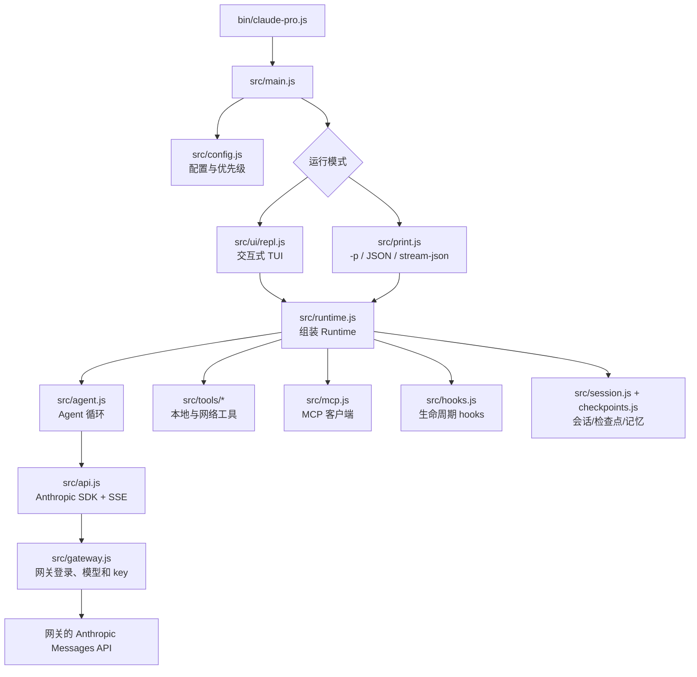
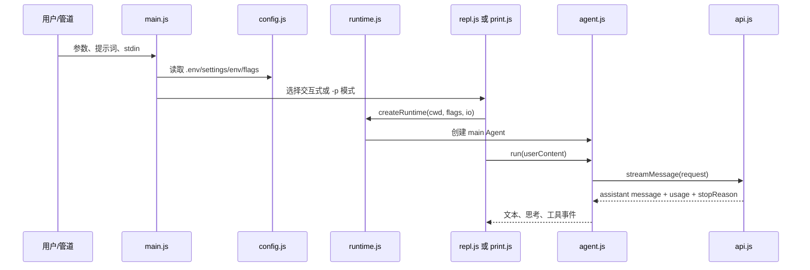
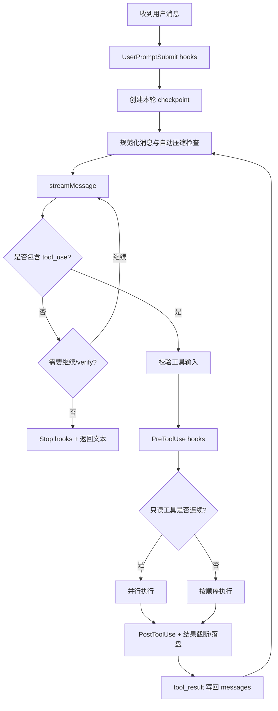

# copy-claude-code 架构说明

本文档说明当前项目的运行时架构、请求链路、工具执行模型、会话持久化方式，以及仅使用 codex-gateway 的实现边界。文档对应仓库当前实现；代码发生变化时，应同步更新本文档。

## 1. 项目定位

`copy-claude-code`（命令名 `claude-pro`）是一个 Node.js 编写的终端 Coding Agent。模型请求只走 codex-gateway：本地通过 `/login` 得到网关 key，网关负责上游模型、账户和计费。claude-pro 不再读取 Anthropic API key、Claude CLI OAuth 或 Codex CLI 登录文件。

| 后端 | 用途 | 凭据来源 | 请求目标 |
|---|---|---|---|
| `gateway` | codex-gateway 账户和模型 | `/login` 保存的网关 key，或 `CLAUDE_PRO_GATEWAY_API_KEY` | `CLAUDE_PRO_GATEWAY_URL`，默认 `https://gw.predix.icu` |

## 2. 总体架构



核心分层可以概括为：

1. `main` 负责命令行入口、参数解析和交互/非交互分流。
2. `runtime` 把配置、Agent、工具、MCP、hooks、任务和持久化组件组装起来。
3. `agent` 负责“发送上下文 → 接收流式模型响应 → 执行工具 → 回填结果 → 继续请求”的循环。
4. `api` 只负责模型请求、SSE 组装、重试和错误归一化；它不执行工具。
5. `tools`、`mcp`、`hooks` 和 `session` 提供 Agent 可调用的能力与状态管理。

## 3. 启动与请求生命周期

### 3.1 进程启动

入口文件是 [`bin/claude-pro.js`](bin/claude-pro.js)，它调用 [`src/main.js`](src/main.js) 的 `main()`：



### 3.1.1 监督进程与自重启

交互式会话（TTY、非 `-p`、非 `config`）由 [`bin/claude-pro.js`](bin/claude-pro.js) 交给 [`src/supervisor.js`](src/supervisor.js)：监督进程用 `stdio: 'inherit'` 把真正的程序作为子进程跑在同一个终端上（环境变量 `CLAUDE_PRO_SUPERVISED=1`、`CLAUDE_PRO_RESTART_FILE=<临时文件>`），子进程以退出码 **75** 结束就再启动一次（带 `CLAUDE_PRO_RESTARTED=1`），其他退出码原样透传；子进程在重启后 15 秒内崩溃会提示"刚加载的代码可能坏了"。监督进程不 import 任何项目代码，所以源码改坏也拖不垮它；它自己的代码（以及 bin）改了只有下次真正启动才生效。

重启流程（[`src/restart.js`](src/restart.js)、`App.requestRestart/restartNow`）：

1. 触发：`Restart` 工具（模型）、`/restart`（用户）、源码监视（`fs.watch` 递归监视 `src/` 和 `bin/`，去抖 400ms，回合结束/空闲时处理）。启动时记下每个 `.js`/`.json` 的内容摘要，事件来了只有内容真的变了（或文件新增、删除）才算：Windows 的 `fs.watch` 连"最后访问时间"更新也报（系统默认开启，读文件时最多每小时更新一次，例如另一个窗口启动、npm 打包），以前会触发无谓的重启。只有 npm 安装的副本（`installedByNpm()`）才把磁盘上更新的 `package.json` 版本当作"别的窗口装了新版本"；源码仓库里改版本号是在发版。
2. 先 `runSelfCheck()`：起一个临时进程 `claude-pro --self-check`（[`src/selfcheck.js`](src/selfcheck.js)）：import 所有入口模块，在假终端里启动真正的 `App`（建 runtime、画欢迎框和输入框）。它用 `selfCheck` 选项而不是测试用的 `noProcessExit`：除了不结束进程，启动路径和真实会话一样（全屏渲染、更新定时器、peers/上线/自动更新的判断都会走到），只用 `CLAUDE_PRO_PEERS=0`、`CLAUDE_PRO_ONLINE=0`、`CLAUDE_PRO_AUTO_UPDATE=0` 关掉对外的副作用；否则只在真实启动时才执行的代码出错，自检查不出来（0.5.2 后的一次重启就这样崩在 `CHECK_EVERY_MS` 未导入上）。然后检查每个工具名/描述/`input_schema`、系统提示词。不通过就不重启，错误返回给模型/用户。
3. 工具触发的重启推迟到**本回合结束**（那条 tool_result 和模型的收尾回复必须先写进会话，否则恢复后会有没有结果的 tool_use）。用户 Esc 打断则取消待定的重启。
4. `restartNow()` 把状态写进 `CLAUDE_PRO_RESTART_FILE`（会话 id/文件、`modelOverride`、`effortOverride`、模式、todos、草稿和光标、排队消息、检查点、最近的重启时间、给模型的提示）后以 75 退出；终端交接时不关原始模式、不关括号粘贴、不弹标题栈。
5. 新进程 `main()` 里 `takeRestartState()` 读取并删除状态文件，忽略命令行里的首个提示词和 `-c/-r`，用状态里的会话；`App.start` 不画欢迎框和历史（旧输出还在屏幕上），只打印一行 `↻ Restarted`，恢复草稿、待办、检查点（`CheckpointStore.adopt`），再把"已重启"提示和排队消息合成一个回合发出去。提示以 `[` 开头，不会被当成会话标题。

`Restart` 工具只在能重启的会话里才构建（子 agent 永远没有），系统提示词里也只有这时才有"你自己的源码"一节。`childEnv()` 会删掉这三个环境变量，Bash 工具启动的子进程不会误以为自己是可重启的会话。

### 3.1.2 远程控制

登录了网关的电脑上，每个交互会话都接在**网关**（`config.gatewayUrl`，默认 gw.predix.icu）的远程控制上，用户在网关用户端的"远程控制"菜单里看和操作它（只限同一账户）；没有开关命令（`/remote-control`、`/rc`、`--rc` 已去掉，`--rc` 仍被接受并忽略），`CLAUDE_PRO_ONLINE=0` 只给自检和测试用；`CLAUDE_PRO_REMOTE_COMMANDS=0` 让这台电脑的会话在网页上只读（能看不能操作）。会话只发出站请求、不监听端口；模型请求和远程控制都使用 `/login` 保存的 key 或 `CLAUDE_PRO_GATEWAY_API_KEY`（`gatewayLogin`）。实现是 [`src/remote.js`](src/remote.js) 的 `RemoteControl`；网关那边的中转和页面在 codex-gateway 仓库。

- **上线与下线**（`App`，[`src/ui/repl.js`](src/ui/repl.js)）：`autoStartRemote` 在启动时（不阻塞）上线：`onlineWanted()`（登录了网关、`CLAUDE_PRO_ONLINE` 不是 0；测试驱动的 App 要显式 `CLAUDE_PRO_ONLINE=1`），或者重启状态里带着 `remote.id`（沿用同一个 id）。`syncRemote()` 让在线状态跟上登录：`/login` 成功后立即调用（当前会话马上上线），`/logout` 直接 `stopRemote()`，另外每 10 秒一次（别的窗口登录/退出、换账号：key 或网关地址变了就断开，没断开的重新连）。网关拒绝的 key 记在 `remoteRefused`，同一个 key 不再自动重试（只提示一次），换了登录才再试。`/status` 用 `remoteState()` 显示状态（在线/连接中/重试中/没登录/key 被拒）。

- **协议**（Bearer = 网关 API key）：
  - `POST /v1/remote/sessions {id, name, title, cwd, host, machine, peerId, model, version, kind, commands?}` → `{id, url}`：注册。`id` 由客户端生成（`newRemoteId`，12 位 base64url），重启后沿用（`handoff()` 写进重启状态），`url` 是会话在网关用户端的页面（网页列表里用；终端不再显示它）。`commands` 声明会话接受的页面指令：`RemoteControl.commands` 按有处理函数的类型给出 `["send","interrupt","dialog","options","suggest","list","output"]`；`CLAUDE_PRO_REMOTE_COMMANDS=0`（`remoteCommandsEnabled`）时 App 不传处理函数，注册不带这个字段，网页上只读。网关只转发声明过的类型，其他的直接回页面 409；不带 `commands` 的会话（0.8.0 等旧版）网页上也是只读，新旧版本两个方向都兼容。
  - `GET /v1/remote/sessions/:id/commands`（SSE）：连着就算在线。收到 `{type:'viewers',count}`（页面数，页脚显示）、`{type:'snapshot'}`（网关要完整快照）、`{type:'peer',cid,…}`（别的会话发来的消息，见 3.1.3）、`{cid:'cmd_…',type,body}`（页面下发的指令，见下面"从页面下发"）。没有处理函数的类型（旧网关会转发所有类型）回 `{ok:false, error}`。50 秒没有任何数据（网关每 15 秒 ping）视为断开；断开后 1s、2s、4s… 最长 30s 重连（连上不到 30 秒又断开的不算恢复，不重置退避），404 表示网关忘了这个会话，先重新注册，401/403 表示 key 被拒，连接结束。
  - `POST …/results`：指令的结果，`{cid, ok: true, …结果字段}` 或 `{cid, ok: false, error}`，网关拿它回复页面的请求（返回 `{ok, delivered}`；请求体最多 4 MB）。处理函数可以返回 promise（`options` 要等网关的模型列表），结果在它完成后再发；网关最多等 15 秒（之后给页面 504），命令流断开后 3 秒内到的结果仍然有效。`close()` 先让出当前调用（页面发来的 `/cd`、`/restart`、`/exit` 在命令处理函数里就关闭会话，它的结果要等处理函数返回才发出），再等在路上的结果发完（`replying`，最多 1.5 秒），然后才断开命令流、发 bye。
  - 网关的错误是 `{type:"error", error:{type, message}}`；注册时一个账户已有 20 个在线会话返回 429，id 被别的账户占用返回 409。
  - `POST …/events {messages:[…]}`：按顺序的 `{t:'snapshot',seq,items,status}`、`{t:'batch',events}`、`{t:'status',status}`、`{t:'bye',restarting}`。网关只存"最新快照 + 之后的事件 + 最新状态"并转发给页面，不需要理解内容。
- **事件模型**：页面看到的是一串条目（`user`、`text`、`thinking`、`tool`、`output`、`summary`），由事件 `user/start/delta/stop/tool/progress/sub/done/output` 更新。归约函数 `applyEvent(state, ev)` 和 `hydrate(items)` 是自包含的，网关页面里有同一份拷贝（codex-gateway 的 `src/user-remote.js` 顶部，改事件语义时两边一起改）。页面渲染在网关那边，它的 CSP 不允许内联样式：ANSI 颜色等用 `data-*` 属性再由脚本设置。每个事件带递增 `seq`，快照带当时的 `seq`，页面丢弃不大于它的事件。
- **上传**：事件攒 150ms 一批，一次只有一个 POST 在路上（保证顺序）；运行中工具的输出（`toolProgress`）只在发送时取最后 8 行。需要快照的时候（刚连上、网关要求、`resync`、上一个 POST 失败、距上次快照超过 500 个事件、有人开始看）发快照代替事件：`snapshotItems` 取最近的条目（最多 400 个、序列化后不超过 1.5 MB，因为网关每个 POST 最多 2 MB、超出返回 413；过长的文本和输出截去中间），并且是**拷贝**（POST 可能排在前一个后面晚些才序列化，那时活的条目已经变了，快照 seq 之后的事件会被重复应用）；失败的 POST 不重发，下一份快照包含了丢掉的一切。没人看（`viewers === 0`）时不上传事件，只在列表用到的字段（忙/闲、标题、模型、目录、名字）变化时发状态，最多每 3 秒一次；有人看时每 500ms 比较一次状态，变了就发。状态由 `App.remoteStatus()` 计算（忙/动词/用时/token、限流倒计时、待办、排队、打开的对话框、模型、目录、标题）。
- **App 的接法**（[`src/ui/repl.js`](src/ui/repl.js)）：`Screen.log` 的每次调用都通过 `screen.onLog` 转成 `output` 事件（命令输出、提示、错误原样带 ANSI，页面转成 HTML）；已经用专门事件表达的打印（用户消息回显 `echoUser`、流式 Markdown、思考、工具头和结果、欢迎框、恢复会话时重印的历史）改走 `logLocal()`，它在打印期间把 `remoteMuted` 加一，不会重复。`streamEvent` 发 `start/delta/stop`，`toolStart` 发 `tool`，进度 `toolProgress`、子 agent 的工具 `sub`，结束/拒绝/中断时 `remoteToolDone()` 发一次 `done`（用 `renderToolResult` 按 100 列排版）。`/clear`（`newSession`）、`/resume`（`loadSession`）、`/rewind` 恢复对话时 `resync()`：按 `agent.messages` 重建条目（`transcriptItems`）并发新快照。新增会改变对话显示的地方时，要么发事件、要么 resync，并把对应的终端打印改成 `logLocal`。
- **从页面下发**（`App.connectRemote` 把处理函数交给 `RemoteControl`，`dialog` 对应 `answer`）：`send` → `remoteSend` 等同在输入框敲回车（`onSubmit`：忙时排队并回 `{queued: true}`、`/命令`、`!`、`#`、`@会话` 都照常）；忙时的 `/命令`、有对话框打开时的普通消息、会话正在退出时直接拒绝（错误作为结果回给页面）；`/exit`、`/quit` 例外：忙时或有对话框时也立即结束会话（取消对话框、中断任务，等同终端里连按两次 Ctrl+C，页面没有这个键）。对话框通过 status 的 `dialog` 暴露（`remoteDialog()`：`id`、`title`、`question`、`body`/`markdown`、选项 `{label, description, other}` 和 `multi`，或文本框的 `input {placeholder, value, multiline}`），按下标回答，因为选项值不一定是字符串；`answerDialog` 校验 `id` 仍是当前对话框再 `resolve`：`{id, index}`、`{id, indices}`、`{id, text, indices?}`（"其他"选项）、`{id, text}`（文本框）、`{id, cancel: true}`。`interrupt` → `remoteInterrupt` 等同 Esc（取消等待中的对话框并中断）。
  - **send 带图片**：`body = {text, images?: [{media_type, data}]}`。`remoteImages()` 校验：最多 6 张；`image/png|jpeg|gif|webp`；base64（允许 `data:…,` 前缀和空白）；解码后不超过 5 MB；`imageSize()` 能读出尺寸（类型和内容对得上）。错误原文（英文，和其他结果一致）：`At most 6 images can be sent at a time (this message has N).`、`The image is image/bmp: only PNG, JPEG, GIF and WebP images can be sent.`、`Image 2 is not base64 data.`、`The image is 6.0 MB: at most 5 MB.`、`The image is not a readable JPEG image.`（一张时说 The image，多张时说 Image N）。之后和 alt+v 粘贴的图片一样走 `onSubmit(value, raw, images)`（忙时进队列，`startTurn` 里 `fitImagesIn` 缩到 1568 px、重 PNG 转 JPEG）。只有图片没有文字时，文字是 `[Image #1] [Image #2]…`，和终端输入框里只粘贴图片后回车发出的一样。
  - **只读查询**（忙时也回答，不在终端产生任何显示）：`options` → `remoteOptions()`：`{model: 当前模型 id, models, effort: 和 status.effort 一样, efforts}`，`models`/`efforts` 来自 `modelChoices(cfg)`/`effortChoices(cfg)`（[`src/commands.js`](src/commands.js)，`/model`、`/effort` 的选择框也用它们），纯文本 `{value, label, description, current?}`，`value` 是 `/model <value>`、`/effort <value>` 接受的值，第一个是 `default`，`current` 标出 `/model`、`/effort` 当前的选择（没选过时是 `default`）；网关模型列表取不到时照 /model 降级（只列 gpt-6.1-sol）。`suggest {text, cursor}` → `remoteSuggest()`：调 `suggest(text, cursor, {quiet: true})`（和输入框同一份：`/命令`、`@文件`、`@会话`；`quiet` 时没有结果也不 `flash`），去掉 ANSI，最多 50 项 `{value, label, description, submitOnEnter, noSpace}` 加 `from`/`to`，没有时 `{items: []}`；`@` 补全时网关会话列表超过 10 秒没更新就先刷新（最多等 3 秒）。`list {path}` → `remoteList()`：[`src/utils/dirs.js`](src/utils/dirs.js) 的 `listDirectory()`（`path` 为空时是会话的工作目录）：`{path, parent, sep, entries: [{name, path}]（只有目录，最多 1000 个）, truncated, home, roots（Windows 的盘符）, recent（recentDirectories：最近有会话运行的目录，30 秒缓存）}`，错误是给页面看的中文。`output {id}` → `remoteOutput()`：这次工具调用的完整结果 `{text, truncated, running?}`，最多 1 MB（UTF-8）：结果引用了 tool-results 里保存的文件（结果太大、Bash 输出被截断、空闲后被清理）时读那个文件；还在运行的（`running: true`）取 Bash 工具经进度回调给的完整输出（`meta.all`），不只是进度里的最后 8 KB。Bash 模式（`!命令`）没有工具调用 id，页面看到的是它的输出行。
  - 页面上改名字、目录、模型、effort 都是发斜杠命令（`/rename <名字>`、`/cd <目录>`、`/model <值>`、`/effort <值>`），和终端里输入一样：带参数时不弹选择框（`/model`、`/effort` 在缓存热时仍会弹 confirmCacheLoss，页面能回答）。
- **`/cd <目录>`**（`App.changeDirectory`）：绝对路径、`~`、`D:`，或相对当前目录的路径（`normalizeDir`，否则 `path.resolve(cwd, …)`）；不存在、不是目录、和当前目录相同时只打印一行，不重启；忙时拒绝；不在监督进程下（`canRestart()` 为假）时报错。否则走重启：`requestRestart({cwd})` → `restartNow` 先用 `moveSession()`（[`src/session.js`](src/session.js)）把会话文件写到新目录的项目目录（`projects/<新目录>/<同一个 id>.jsonl`，第一行 meta 的 `cwd` 换成新目录，`/resume` 在新目录能找到，`SessionStore(cwd, id)` 也接着往这里写），重启状态里带 `cwd` 和 `changedDirectory: true`，写成功后才删旧文件（写失败就删新文件、不重启）。新进程的 `main.js` 在取到重启状态后 `process.chdir(state.cwd)`（监督进程总是在第一次启动的目录里拉起子进程，所以之后每次重启的状态里都带 `cwd`），于是项目设置、CLAUDE.md、auto memory、系统提示词里的目录和 git 状态、`@` 文件索引、输入历史全部按新目录加载。保持不变的：对话、远程控制 id（`handoff()`）、模型/effort/模式、待办、排队的消息、草稿；`/rename` 或 `--name` 起的名字（`customTitle` 不为空）通过 `peerName` 带过去，按目录取的默认名字不带（新进程按新目录名取，网关注册时 `name`、`cwd` 都是新的）。`/cd` 不计入"5 分钟 5 次"的重启循环保护。新进程在 `resumeAfterRestart` 里打印 `Working directory: <目录>`（代替"↻ Restarted"），并把这一行放进 `seedOutput`，远程控制的初始条目（`seed()`）在对话后面带上它，所以页面重新拿到快照后也看得到；`/clear`、`/resume` 清空它。
- **退出与重启**：`close({restarting})` 把剩下的消息和 `{t:'bye',restarting}` 一起发出，进程等它最多 1.5 秒再退出。重启后的新进程用同一个 id 注册（`persistent`：网关暂时连不上也不放弃，后台重试），网关上的页面看到同一个会话回来并收到新快照。

### 3.1.3 会话之间的消息（本机和其他电脑）

本机的会话经 [`src/peers.js`](src/peers.js) 的 `PeerNode` 互发（`CONFIG_DIR/peers/<id>.json` 登记、127.0.0.1 上的小 HTTP 服务）；同一网关账户下其他电脑上的会话经网关，复用远程控制那条连接（`RemoteControl`）：

- **在线**：登录了网关的电脑上，交互会话启动时连上网关（见 3.1.2 的"上线与下线"）。注册时带 `machine`（`machineName()`：`CLAUDE_PRO_MACHINE_NAME` 或主机名；网页据此把会话归到电脑下）和 `peerId`（本机 PeerNode 的 id，列表里据此去掉本机已经能直接联系的会话）。
- **列表**：`GET /v1/remote/sessions` → 同账户的会话（在线的在前）。`App.refreshRemotePeers()` 只留在线、未结束、不是自己、不在本机的，变成 `{id, name, machine, cwd, remote: true, label: 'machine/name'}` 存在 `remotePeers`；连上时、每 60 秒、输入 `@` 时（超过 10 秒没刷新）、发送时找不到名字时刷新。
- **寻址**：`resolvePeer(local, remote, ref)`：本机名字优先；然后 `machine/name`、只有一个远端会话叫这个名字、只有一个会话的电脑名、（模型发的才有）id 前缀；多个匹配时报歧义。用户与模型使用的会话前缀统一为 `@`：`suggest()` 在同一个 `@` 入口中合并文件和本机/远端会话补全，`sendTypedToPeer` 发送。
- **发送**：`POST /v1/remote/sessions/:目标/messages {from: 自己的 id, kind, text, inReplyTo}` → `{id, delivered}`（不重试：任务发两次会做两次）。网关按发送方的注册信息填 `from`，推到目标命令流：`{type:'peer', cid, kind, text, inReplyTo, from:{id, name, machine, host, cwd}}`。task 发给不在线的会话返回 409；reply 进目标的信箱（内存，24 小时，100 条 / 4 MB），目标重连时（viewers 之后）按顺序重推。
- **接收**：`RemoteControl.peerMessage` 按 `cid` 去重（重推的消息只确认），交给 `App.onPeerMessage`（`from.name` 是 `machine/name`，`from.remote = true`），然后用 `POST …/results {cid, ok: true}` 确认，确认后网关从信箱删除。之后的流程和本机消息相同：任务排队成一轮，`answerPeers` 在这一轮结束后把最终文本作为 reply 发回，远端的经网关（`remote.sendPeer`），本机的经 PeerNode。
- **`@` 补全**：`suggest()` 在光标前是 `(行首|空白)@词` 时把文件和会话放进同一列表（文件保留目录与带空格路径的引号逻辑，会话项显示本机/电脑和目录），所以句中的 `@公` 也能补全。行首命中会话的 `@名字 任务` 直接发送；文件和会话同名时用 `@./名字` 强制文件；其他位置的 `@名字` 由 `peerMentions` 解析后作为 system-reminder 告诉模型是哪个会话、可以用 MessagePeer 联系它。附带的图片如果来自文件（`source`），把路径也告诉模型。
- **名字**：`/rename`（`App.renameSession`）改本机 PeerNode 的名字（`setName` 在本机重名时加 -2），没有 PeerNode 时记在 `sessionName`；同时作为对话标题 `customTitle`（`sessionLabel()` 优先用它，`refreshTopic` 不再改标题），写进会话文件的 meta `name`（`/resume` 时恢复名字和标题）；再向网关注册一次（网关用注册时的 name 填 `from`），并推一次状态（网关列表用状态里的 name）。名字允许任何文字的字母（`cleanName` 用 `\p{L}\p{M}\p{N}`）。

### 3.1.4 输入框的光标与回退菜单

- **可视行**：[`src/ui/editor.js`](src/ui/editor.js) 的 `layoutRows(body, textW)` 把文字按输入框宽度排成显示的行，每行带光标停靠点 `{i, col}`（每个下标恰好一个停靠点：折行处的字在下一行行首，换行符处是上一行行尾）。`render` 用它画输入框，`moveRow` 用它上下移动，所以自动折行的长行也能逐行移动；连续上下移动时 `goalCol` 记住起始列。第一行按上：文字不止一行且光标不在开头时先到开头，再按才 `historyPrev`；最后一行按下同理。`textW` 是上次绘制时的宽度。
- **双击 Esc**：输入框有文字时清空（`discard`，按上可找回）；为空时调用 `onDoubleEscape` → `App.openRewind()`（忙时 Esc 先中断，不会打开）。Node 的按键解析在 Esc 之后要等约 500ms 判断它是不是组合键的开头，连按的两个 Esc 常常合成一个带 `meta` 的 escape，两种都算连按。
- **回退菜单**（`/rewind`，[`src/commands.js`](src/commands.js)）：按时间列出检查点（最新的在最下、默认选中，`SelectDialog` 的 `selected`），`/clear` 前的对话（`app.previousSession`，在 `/clear` 里记下，`loadSession` 清掉）在最上面。动作：恢复代码和对话 / 对话 / 代码（`rewind()`）、Summarize from here / up to here（`Agent.summarizePart(index, {part: 'after'|'before'})`：整段对话加上 `partialCompactPrompt` 作为一次摘要请求，走 `requestSummary` 以复用缓存；被总结的部分换成一条 `partialSummaryMessage`，其余逐字保留；然后 `CheckpointStore.summarized` 让被总结的回合不能再回退对话、把之后的回合的 `messageIndex` 前移）、Never mind（回到列表）。回填输入框的是 `promptAt(agent, entry)`：检查点所在的那条用户消息的完整文字（标签只存前 200 字）。

### 3.2 交互式与非交互式

- 交互式终端进入 [`src/ui/repl.js`](src/ui/repl.js)，负责输入编辑、Markdown 渲染、流式输出、快捷命令和中断。
- `-p/--print` 或检测到非 TTY 时进入 [`src/print.js`](src/print.js)。可输出 `text`、`json` 或 `stream-json`，适合脚本和管道。
- `/continue`、`--continue`、`--resume` 使用 [`src/session.js`](src/session.js) 查找并加载当前项目的 JSONL 会话。
- `config list/set/unset` 在 `main.js` 中直接处理，不启动 Agent。

## 4. Runtime 组装

[`src/runtime.js`](src/runtime.js) 是依赖装配中心。`createRuntime()` 按以下顺序工作：

1. 调用 `loadConfig({ cwd, flags })` 得到有效配置。
2. 清理过期的大工具结果和旧检查点。
3. 创建 `ModeManager`、`CheckpointStore`、`HookRunner`、`BackgroundTasks`。
4. 加载内置/自定义 Agent 和 Skills。
5. 启动 `.mcp.json` 或 settings 中声明的 MCP servers。
6. 根据配置查找 Bash shell。
7. 调用 `buildTools()` 生成主 Agent 工具集合。
8. 生成主 Agent system prompt，并按需加载项目自动记忆。
9. 创建主 Agent，并注册后台子 Agent 完成通知。

运行时对象的主要字段如下：

| 字段 | 作用 |
|---|---|
| `config` | 有效配置、模型解析、上下文窗口和限制 |
| `checkpoints` | 文件编辑前快照和 `/rewind` |
| `agents` / `skills` | Agent 定义和 Skill 定义 |
| `mcp` | MCP server 连接与动态工具 |
| `shell` | Bash/Windows shell 执行适配 |
| `hooks` | `UserPromptSubmit`、`PreToolUse`、`PostToolUse`、`Stop` |
| `tasks` | 前台/后台子 Agent 任务表 |
| `tools` | 主 Agent 最终可见工具列表 |
| `systemPrompt` | 延迟构建、可失效重建的系统提示词 |
| `agent` | 深度为 0 的主 Agent |

子 Agent 使用同一个配置、模式、检查点和 hooks，但拥有自己的消息上下文、IO 和深度。`toolsForSubagent()` 会按 Agent 定义过滤工具，并使用 `maxSubagentDepth`（2）。

## 5. 配置体系与 gateway provider

### 5.1 配置优先级

[`src/config.js`](src/config.js) 从低到高合并：

1. 内置默认值；
2. 安装目录 `.env`；
3. `~/.claude-pro/settings.json`；
4. 当前项目 `.claude-pro/settings.json`；
5. 当前项目 `.claude-pro/settings.local.json`；
6. 进程环境变量；
7. 命令行 flags。

provider 固定为 `gateway`。`--provider api`、`--provider claude-code` 和 `--provider codex` 会被拒绝；旧的 API、Claude CLI 和 Codex CLI 凭据不会参与配置解析。模型使用 `CLAUDE_PRO_GATEWAY_MODEL`，也可以用 `/model` 或 `--model` 临时覆盖。

```powershell
node bin/claude-pro.js config list
node bin/claude-pro.js config set CLAUDE_PRO_GATEWAY_MODEL sonnet
node bin/claude-pro.js --provider gateway --model opus
```

### 5.2 gateway 请求路径

`src/api.js` 每次请求从 `gateway.json` 或 `CLAUDE_PRO_GATEWAY_API_KEY` 读取 key，通过 Anthropic Messages 格式向 `${CLAUDE_PRO_GATEWAY_URL}/v1/messages` 发送请求。模型、工具 schema、SSE 事件、重试、上下文压缩和取消逻辑都在本地 Agent 层保持不变；远程控制也复用同一个网关账户，但使用独立的 remote API 路径。

## 6. gateway 请求与限流

### 6.1 gateway 后端

[`src/api.js`](src/api.js) 对上层暴露统一的 `streamMessage()` 和 `quickQuery()`。上层只看到 gateway 的 Anthropic Messages 兼容接口：

```text
Agent / WebFetch / 标题摘要
          │
          ▼
      streamMessage
          │
          └─ gateway → CLAUDE_PRO_GATEWAY_URL + gateway key
```

### 6.1.1 限流：暂停到窗口重置再自动继续

网关账户有滚动窗口限额（5 小时、每周）。窗口用完时网关返回 429，并在响应头里给出是哪个窗口、何时重置：

| 响应头 | 含义 |
|---|---|
| `anthropic-ratelimit-unified-status` | `allowed` / `allowed_warning` / `rejected` |
| `anthropic-ratelimit-unified-reset` | 代表性窗口的重置时间，**秒级 epoch** |
| `anthropic-ratelimit-unified-representative-claim` | `five_hour` / `seven_day` / `seven_day_opus` / `seven_day_sonnet` … |
| `anthropic-ratelimit-unified-overage-status` | 额外用量是否还能接手；仅当它也是 `rejected`（或缺失）时，重置时间才算等待时间 |
| `retry-after` | 普通 API 的限流提示（秒或 HTTP 日期） |

[`src/ratelimit.js`](src/ratelimit.js) 把这些转成决策，`streamMessage()` 在重试循环里执行：

```text
429
 ├─ 响应头说 ≥30 秒后重置（5 小时/每周窗口） → rate_limit_wait：暂停到重置时间 + 2s 余量 + 0–8s 抖动，原样重发
 ├─ 响应头说 <30 秒                          → 普通快速重试（计入重试次数，最多 max(MAX_RETRIES,10) 次）
 └─ 没有任何时间信息                         → 1s、2s、4s… 退避，上限 5 分钟（rateLimitPoll）
 总等待受 CLAUDE_PRO_RATE_LIMIT_MAX_WAIT_MS（默认 6 小时）限制；超出则报错并写明重置时间。
```

- 暂停通过 `onEvent` 报告：`rate_limit_wait`（含 `resumeAt`、`resetAt`、窗口名）和请求被接受后的 `rate_limit_resume`。这些事件有三类来源，每个界面都要接：主 agent 一轮的请求（`io.streamEvent`）、主 agent 的压缩（`io.compactProgress`）、子 agent（`io.subagentIo()` 返回的对象，它的 `streamEvent` 和 `compactProgress` 都要接——子 agent 自己的对话也会自动压缩，漏接 `compactProgress` 就是几小时的无声暂停）。REPL 对前两者显示实时倒计时（`rateWait`），对子 agent 只打一行带 `[名字]` 前缀的通知；`-p` 模式都打印到 stderr。
- 轮询型暂停每隔几分钟会再发一次 `rate_limit_wait`，`shouldAnnounce(prev, ev)` 决定是否值得再告诉用户一次（只有首次，或重置时间移动超过 2 分钟）。REPL（主 agent 和每个子 agent）与 `-p` 都用它；新增界面时别忘了。
- 等待用墙上时钟分段休眠（`sleepUntil`，每段最多 15 秒）：电脑睡眠后醒来立刻发现已过重置时间。`timing` 对象可被测试替换，几小时的等待在测试里瞬间完成。
- 暂停可被 `AbortSignal` 取消（Esc）。自动压缩期间也一样：`Agent.compactOnTheWay()` 把压缩中的中断映射成"本轮被打断"（`handleInterrupt`），而不是让 `AbortError` 逃出 `run()` 变成"API Error: aborted"。
- 醒来后重新发送原请求；暂停结束后 `retryState.attempt` 清零，暂停之前的快速重试不占暂停之后的名额。
- `quickQuery()` 默认 `waitForRateLimit: false`：旁路请求（`/doctor`、WebFetch 的摘要）没有事件通道，无法告诉用户自己停住了，所以直接报告限流。没人等限流的场景（这个选项，或 `CLAUDE_PRO_RATE_LIMIT_MAX_WAIT_MS=0`）里，`planRetry` 对 ≥30 秒的 429 立即报告重置时间，不再按 Retry-After 一次次静默地等。
- 界面里"忙碌"的东西（一轮、压缩、`/doctor`、`!` 命令）结束时都要调用 `App.sendWhatWaited()`：忙碌期间排队的输入和刚结束的后台 agent 的报告由它发出。漏掉它，排队的消息就一直停在"queued"。
- `CLAUDE_PRO_MAX_RETRIES=0` 关闭一切重试，包括等待。

### 6.2 请求形态

SDK 最终调用网关提供的 Anthropic Messages 兼容接口，逻辑路径相当于：

```text
POST https://gw.predix.icu/v1/messages
Authorization: Bearer <gateway API key>
X-Claude-Code-Session-Id: <session id>
```

请求体由 `buildParams()` 生成，关键字段包括：

- `model`、`max_tokens`、`stream: true`。
- claude-pro 自己生成的一个 system prompt block；不会追加 Claude Code 身份声明。
- `messages`，保留 Anthropic 的 `tool_use` / `tool_result` 结构。
- 工具 JSON Schema；最后一个工具带 `cache_control`（提示词缓存，见 6.5）。
- `output_config.effort` 和可选的 thinking budget；GPT 模型的思考签名按网关 Codex 后端协议保留。

图片（[`src/utils/images.js`](src/utils/images.js)）：每次请求都带着整个对话，所以图片的字节数决定请求有多大（token 按像素算，与字节无关）。`fitImage` 把长边超过 1568 px 的缩到 1568；超过 `PNG_AS_JPEG_BYTES`（512 KB）的 PNG 另存一份 JPEG（质量 85，透明部分铺白），更小就用 JPEG。3D 场景、照片类截图用 PNG 几乎压不动：723×1568 的游戏截图 PNG 2.3 MB，JPEG 180 KB。没有图片库：Windows 用 PowerShell 的 System.Drawing，macOS 用 sips，其他系统用 ImageMagick。Read、粘贴/拖入的图片、所有工具结果都先经过它。已经在对话里的重 PNG（这个功能之前读的截图）由 `Agent.lightenImages()` 处理：`callModel`、`compact`、`summarizePart` 发请求前调用 `lightenImagesIn(this.messages)` 原地换成 JPEG（每批 4 个并发），有改动就 `replaceMessages` 写一条 reset 进会话文件，并告诉 `CacheStats` 接下来的整段重写是预期的；转不了或 JPEG 不更小的按数据 sha1 记住，不再每次请求都试。2026-10-12 的事故：一个对话读了 11 张 PNG 截图，请求体到了 31 MB，网关处理时内存 350–450 MB，被 pm2 的 300M 上限每 30 秒杀一次，客户端看到的是 `terminated` 和 Caddy 的 `502 (no body)`；网关和 API 对单个请求的上限都是 32 MB。

### 6.4 SSE 组装与认证轮换

`streamMessage()` 解析 `message_start`、`content_block_*`、`message_delta` 和 `message_stop`，将文本、thinking、tool input JSON、usage、stop reason 组装成完整 assistant message，并通过 `onEvent` 推送给 UI。

错误处理包含：

- Abort signal 取消请求和工具执行。
- 400 返回 `max_tokens` 过大时，学习服务端上限并立即重试。
- 408/409/429/5xx 的指数退避重试。
- 400 "This model does not support the effort parameter"（Haiku）时去掉 `output_config` 立即重试，并记住这个模型（`effortSupported()`），之后不再发送。
- prompt too long 时通知 Agent 触发上下文压缩。
- 400 报 `cache_control`（或 `ttl`）不被接受时，`refuseCache()` 在被点名的位置去掉标记（报 `ttl` 则退回 5 分钟）后立即重发；没点名位置的报错一次去掉一处（messages → tools → system）。去掉了什么先记在这次调用里，请求成功后才按"端点 + 模型"记住（`cacheRefusals()` 给 `/status`），所以只是碰巧提到 `cache_control` 的报错不会让缓存永久关闭；没有可去掉的标记时照常报错，不会循环。

### 6.5 提示词缓存

实现在 [`src/cache.js`](src/cache.js)（TTL 规则、`cache_control` 构造、命中统计）、`buildParams()` / `streamMessage()`（标记与降级）和 `Agent`（用量记录、压缩）：

- **断点**：最后一个工具、系统提示词、最新消息的最后一个块，共 3 个。gateway 请求只有 claude-pro 自己生成的 system prompt block。`quickQuery()`（WebFetch 摘要、标题等一次性请求）传 `cacheMessages: false`，消息不标记：整页内容只发一次，写缓存只会多收 1.25 倍。
- **TTL 桶**：`buildParams(…, { cacheBucket })`，`main`（主 agent 的每轮请求）和 `other`（子 agent、压缩、`quickQuery`）。`Config.cacheTtl(bucket)` 的优先级：`FORCE_PROMPT_CACHING_5M` → 桶自己的变量/设置（`CLAUDE_CODE_PROMPT_CACHE_TTL`、`CLAUDE_CODE_SUBAGENT_PROMPT_CACHE_TTL`，设置项 `promptCacheTtl`、`subagentPromptCacheTtl`）→ `ENABLE_PROMPT_CACHING_1H` → 默认值：gateway 的 `main` 桶是 1 小时，`other` 桶是 5 分钟。变量优先于设置项，无论来自哪个文件（设置项单独保存在 `config.settings`，不写进 env）；无效的值被忽略。5 分钟不发 `ttl` 字段；端点不认 `ttl` 时退回 5 分钟（见上）；一个请求里所有标记同一个 TTL（API 要求长 TTL 在前）。
- **配置直接传给网关**：gateway 使用配置文件和环境变量中的 effort、自动压缩窗口、最大输出和 thinking 预算。
- **开关**：`Config.promptCachingDisabled(modelId)`，`DISABLE_PROMPT_CACHING` 和按别名/模型的变体；关闭时请求里没有任何 `cache_control`。
- **压缩**：`Agent.requestSummary()` 发的是对话自己的请求（同一模型、系统提示词、工具、effort、思考设置），摘要指令作为最后一条用户消息的末尾块，属于 `other` 桶。得不到摘要（模型调工具）或 prompt too long 时退回 `SUMMARY_SYSTEM` + 无 effort 的普通请求，这一次不计为 miss。压缩完成后 `refreshSystemPrompt()` 让系统提示词在下一次请求时重建。**不要给压缩请求加 `tool_choice`、改 effort 或 `max_tokens` 与 thinking 的关系**：这些会改变缓存键。调用了工具的回复、被输出上限截断且没写完 `</summary>` 的回复都不算摘要（`Agent.summaryOf()`），会退回普通请求；仍不行则报错并保留对话。子 agent 自己的压缩不会让主对话的检查点失效。压缩之后不会再有请求以这段历史开头，所以只在能从缓存读到它时才给消息加标记：`Agent.cacheExpired()` 确定缓存已过期时（本进程上次请求的 `expiresAt`；恢复/重启的对话用最后一条消息的时间加主对话 TTL，不知道就当没过期），以及退回的普通请求，都传 `cacheMessages: false`，历史按普通输入计费（4 美元/M），不按缓存写入（5 美元/M）；工具和系统提示词的标记保留，下一轮还要读。
- **系统提示词不在会话中途变化**：`runtime.systemPrompt()` 构建一次并保持。保存记忆、`/config set` 只调用 `deferSystemPromptRefresh()`（`systemPromptStale`），`/clear`、压缩、`/model` 调用 `invalidateSystemPrompt()`。日期和 git 状态是一份快照（`takeEnvSnapshot()`），主提示词和子 agent 提示词共用，所以同类型子 agent 反复启动的前缀相同。
- **恢复**：`SessionStore.setSystemPrompt()` 把当时的系统提示词写进会话文件（`meta` 记录，最新的生效）；`runtime.resumeSystemPrompt()` 在恢复时继续使用它（模型不同、或本次 `--append-system-prompt` 文本不同则不用），`Agent.resetConversation()` 清掉 `recordedSystem`，所以 `/clear` 之后的新会话文件也会写入（即使文本相同），日期不同则通过 `Agent.addReminder()` 在下一条用户消息末尾附一条提醒（在已缓存部分之后，不破坏缓存）。
- **统计**：`CacheStats`（`agent.cache`）按 API 报告的 `cache_read_input_tokens` / `cache_creation_input_tokens` 记录命中率、miss 次数、是否还热（TTL 从请求开始算）和最近一次 miss 的可能原因（模型/系统提示词/工具/effort/思考设置变了，或缓存已过期）。历史被改写（压缩、`/rewind`）和新对话不算 miss。`Agent.recordUsage()` 是唯一累计用量的地方，压缩请求也走它；子 agent 的用量在结束时（无论成败）并入主 agent（`addSubUsage()`），`totalUsage()` 给出总数。
- **切换确认**：缓存还热（`agent.cache.isWarm()`）时 `/model`、`/effort` 先确认；已经过期、新对话、端点不报告缓存用量时不问。
- **空闲保温**：[`src/keepalive.js`](src/keepalive.js)（`agent.keepAlive`，只有主 agent 有）。Claude 模型、1 小时 TTL、缓存还热且至少 2 万 token 时，在缓存到期前 5 分钟把对话的上一个请求原样再发一次，只改 `max_tokens: 1`（`Agent.keepAliveRequest()`：最后一条回复之前的消息，规范化和修复的结果与当时相同）。读缓存会刷新 TTL，费用是重写的 1/40；2026-10-25 在网关上实测：读到全部 19,440 token、没有写入、只有 1 个输出 token；5 分钟 TTL 的对照实验里，刷新过的缓存过了原到期时间仍然命中，没刷新的已经过期。发送前用 `fingerprint()` 对比上一个请求（系统提示词、工具、模型、effort、思考设置），不同就不发（否则会整段重写）；离到期不到 1 分钟（电脑睡眠过）、请求超过截止时间、遇到限流都不发也不重试。一次停顿最多保温 `CLAUDE_PRO_CACHE_KEEPALIVE_HOURS` 小时（默认 8，0 关闭）。刷新没命中会提示并停止，到用户下一条消息为止。`run()`、`requestSummary()` 进行中不保温（`agent.busy`），开始时 `stop()` 中止正在发的刷新；`replaceMessages()`、`resetConversation()` 也会停止。缓存还热时 `clearAfterIdle()` 不清理。状态通过 `CacheStats.snapshot()` / `restore()` 随 `setCacheUntil()` 写进会话文件，`reset` 记录会使其失效，所以重启后能继续保温。GPT 不做：轨迹显示停顿 2–4 小时后 9 次里有 8 次仍然命中，而且 miss 按普通输入计费，不是缓存写入。`/cost` 会显示刷新次数和花费。
- **空闲后清理**：`Agent.clearAfterIdle()` 在主 agent 每轮开始时（`beforeTurn` 之后）看距 `lastActivityAt` 是否超过 65 分钟（`IDLE_CLEARING`；`pushMessage()` 更新它，恢复会话时取会话文件里最后一条消息或 reset 的时间 `SessionStore.load().lastAt`），超过就调 `clearOldToolResults()`：可清的工具（Read、Bash、BashOutput、Grep、Glob、WebFetch、WebSearch、Edit、Write）的结果里，最近 5 个以外、不小于 100 token、还没清过也不是落盘预览的，换成 `[Old tool result content cleared]` 占位（Read 提示重读；其他的全文存到 `tool-results/<id>.txt`，占位里给出路径），合计不足 2 万 token 就不动。同时去掉所有 thinking 块：改了早先的 tool_result，后面的 thinking 就失效（新账号直接 400）。结果经 `replaceMessages()` 写进会话文件（reset 记录），被清的 Read 所在文件若再没有可见的 Read 就移出 `fileState`（Edit/Write 前必须重读），`lastContextTokens` 按清掉的量下调。上一轮停在未完成的工具调用（最后一条助手消息带 tool_use，比如工具结果之后的请求失败或被中断）时，只有手动思考（`MAX_THINKING_TOKENS`，`thinking.type: "enabled"`）不清：API 要求这条消息以它的 thinking 开头。自适应思考（不发 thinking 字段时的默认，5.x 模型只有这一种）没有这个要求，文档也允许删掉全部 thinking，照常清。gateway 始终启用这项清理，因为网关提示词缓存会过期。
- **日期**：系统提示词在会话中不重建，所以跨过午夜后它的日期是旧的。`runtime.noteDateChange()` 在主 agent 每轮开始时（`Agent.beforeTurn`）比较提示词里的日期和今天，不同就用 `addReminder()` 附一条新日期的提醒，每天一次；恢复会话时 `resumeSystemPrompt()` 做同样的事。

改动会影响请求前缀的东西（系统提示词、工具描述、`output_config`、`thinking`）之前，先想一想它会不会在会话中途变化：变一次就是整段历史重写一次。

## 7. Agent 循环与工具调用

[`src/agent.js`](src/agent.js) 是项目的核心状态机。一次用户请求的主要路径如下：



关键行为：

- 连续只读工具（例如 `Read`、`Glob`、`Grep`）可以并行；编辑、Bash 等有副作用的工具按顺序执行。
- 每个工具调用都会经过输入 JSON/schema 校验和 hooks。
- `Write`、`Edit`、`MultiEdit`、`NotebookEdit` 在执行前写入检查点；Bash 造成的文件变化不在检查点覆盖范围内。
- 超大的工具结果保存到 `tool-results` 文件，只把预览和路径发回模型，避免挤占上下文。
- 配置 `CLAUDE_PRO_VERIFY_COMMAND`、`--verify` 或 `/verify` 后，完成文件修改的回合会执行验证命令；失败输出会再次交给模型修复，最多执行 3 轮（`verifyMaxRounds`）。
- 到达上下文阈值或收到 prompt-too-long 错误时，使用 `compact()` 生成摘要，并通过 reset 记录替换旧消息；摘要请求复用对话自己的提示词缓存（6.5）。自动压缩失败时（`compactOnTheWay`），只要请求还放得下，这一轮照常继续；连续失败 `MAX_COMPACT_FAILURES`（3）次后本对话不再自动压缩，直到 `/compact` 成功或 `/clear`。prompt-too-long 时的压缩失败仍然报错结束这一轮。
- 工具结果只放必要的内容：Edit 只回一行和改动的行号范围（不再附带 `cat -n` 片段）；Read 一次最多返回 40 万字符，截断时写明最后显示的是哪一行。

## 8. 工具与扩展点

主 Agent 的工具由 [`src/tools/index.js`](src/tools/index.js) 汇总：

| 类别 | 工具/实现 |
|---|---|
| 文件 | `Read`、`Write`、`Edit`、`MultiEdit`、`NotebookEdit`；Read 的行号不补空格（`12\t`，GPT 上每行省 2 个 token）；Edit/MultiEdit 的 old_string 在当前文件里唯一匹配就能改（没读过也行），没找到时报错里给出最相似的几行；MultiEdit 一次调用改一个文件的多处，按顺序、要么全改要么全不改（GPT 几乎从不在一次回复里发多个 Edit）；Write 要先完整读过；只有时间戳变而内容没变不算外部修改；保留 CRLF/BOM 和编码 |
| 搜索 | `Glob`、`Grep`；优先使用 ripgrep，缺失时使用 JS fallback |
| Shell | `Bash`、`BashOutput`、`KillShell`；支持 cwd、超时、后台进程和输出落盘 |
| Web | `WebFetch`、`WebSearch`；包含 HTML 转 Markdown、缓存和摘要查询 |
| Agent | `Task`、`TaskOutput`、`TaskStop`；支持前台和后台子 Agent |
| 交互 | `TodoWrite`、`AskUserQuestion` |
| 扩展 | `Skill`、MCP 动态工具 |

### MCP

[`src/mcp.js`](src/mcp.js) 支持：

- `.mcp.json` 或 settings 的 `mcpServers` 配置。
- stdio server：启动子进程，通过 JSON-RPC 通信。
- streamable HTTP server：使用 JSON-RPC、`MCP-Protocol-Version` 和 session header。
- 启动时 `initialize`、`tools/list`，再把工具转换为 `mcp__<server>__<tool>` 形式交给模型。

### Hooks

[`src/hooks.js`](src/hooks.js) 执行 settings 中的 command hooks。事件 JSON 同时通过 stdin 和 `CLAUDE_PRO_HOOK_INPUT` 传递，并设置 `CLAUDE_PROJECT_DIR`：

- 退出码 `0`：通过，stdout 作为额外上下文。
- 退出码 `2`：阻断操作，stderr 返回模型。
- 其他非零退出码：警告但默认不阻断。

### Skills 与自定义 Agent

[`src/agents.js`](src/agents.js) 加载内置 Agent、项目/用户自定义 Agent 和 Skills。自定义定义的目录，例如 `.claude/agents`、`.claude/skills`、`.claude-pro/skills` 和用户级目录。

## 9. 会话、检查点与项目状态

状态根目录由 `CLAUDE_PRO_CONFIG_DIR` 控制，默认是 `~/.claude-pro`。当前项目路径会被规范化后放在 `projects` 下：

```text
~/.claude-pro/
├─ settings.json                 # 用户级配置
└─ projects/<sanitized-cwd>/
   ├─ <session-id>.jsonl         # 会话 meta/message/reset
   ├─ tool-results/              # 超大工具结果，默认清理 7 天前文件
   ├─ checkpoints/               # 文件快照，默认清理 14 天前目录
   └─ memory/                    # 自动记忆索引和主题文件
```

这些是本项目自己的会话状态；模型请求使用网关登录，不读取其他 CLI 的凭据或对话历史。`--continue` 和 `--resume` 读取的是上述 JSONL。

检查点只覆盖文件工具在修改前记录的文件。通过 `/rewind` 可选择恢复代码、恢复对话或两者同时恢复；Bash 的任意副作用需要用户自行处理或通过 hooks/验证命令控制。

## 10. UI 与权限边界

项目有意采用“工具直接执行”的权限模型：没有 allow/deny 询问框，也没有权限审批队列。旧的权限相关 flags（以及 `--plan`）会被兼容解析但忽略。没有计划模式（0.7 之后去掉了）：要先出方案，用户在消息里说即可；唯一的执行门控是 PreToolUse hook。

这意味着：

- `Bash`、网络访问、文件写入和 MCP 工具默认可以立即执行。
- 生产或共享环境应使用 hooks、隔离工作目录、版本控制和验证命令增加保护。
- 网关认证只解决模型请求认证，不会限制模型可以调用的本地工具。

## 11. 目录与模块索引

| 文件/目录 | 责任 |
|---|---|
| [`bin/claude-pro.js`](bin/claude-pro.js) | CLI 启动器 |
| [`src/main.js`](src/main.js) | 参数解析、config 子命令、模式分流 |
| [`src/config.js`](src/config.js) | 配置来源、provider、模型和限制 |
| [`src/runtime.js`](src/runtime.js) | 依赖装配和 Agent 创建 |
| [`src/agent.js`](src/agent.js) | 消息循环、工具调度、压缩、验证 |
| [`src/api.js`](src/api.js) | Anthropic SDK、SSE、重试、错误 |
| [`src/ratelimit.js`](src/ratelimit.js) | 限流响应头解析、等待决策、墙上时钟休眠、提示文案 |
| [`src/filestate.js`](src/filestate.js) | 恢复会话时重建“已读文件”状态 |
| [`src/utils/shell.js`](src/utils/shell.js) | Shell 启动、`watchShell`（输出收集与结束判定）、Windows 进程树终止 |
| [`src/supervisor.js`](src/supervisor.js) | 监督进程：子进程退出码 75 时重启它（只用 Node 内置模块） |
| [`src/restart.js`](src/restart.js) / [`src/selfcheck.js`](src/selfcheck.js) | 重启状态交接、启动检查、源码监视 |
| [`src/tools/`](src/tools/) | 文件、Shell、搜索、Web、Task、Skill 等工具 |
| [`src/mcp.js`](src/mcp.js) | MCP stdio/HTTP 客户端 |
| [`src/hooks.js`](src/hooks.js) | 生命周期 command hooks |
| [`src/session.js`](src/session.js) | JSONL 会话、工具结果、自动记忆目录 |
| [`src/checkpoints.js`](src/checkpoints.js) | 文件快照与回滚 |
| [`src/ui/`](src/ui/) | 终端屏幕、编辑器、Markdown、对话 UI |
| [`src/remote.js`](src/remote.js) | 远程控制：经网关中转的客户端、事件归约（网关页面里有同一份） |
| [`src/peers.js`](src/peers.js) | 本机会话之间的消息（注册表 `peers/<id>.json` 和 127.0.0.1 上的小 HTTP 服务） |
| [`src/print.js`](src/print.js) | 非交互输出协议 |

## 12. 测试与验证

没有测试套件（2026-10-20 移除）。`npm run check` 是约 1 秒的启动自检（`--self-check`，见 [`src/selfcheck.js`](src/selfcheck.js)）：加载所有入口模块，在假终端里启动真正的 `App`，检查工具定义和系统提示词；每次重启前也会先跑它。其余验证按改动的风险决定，细则见仓库根目录的 [`CLAUDE.md`](CLAUDE.md)。

## 13. 修改代码时的建议

网关协议或模型能力变化时，应保持 `Agent` 不感知认证细节，只在 `config.js`、`gateway.js` 和 `api.js` 的 client/params 边界扩展。新增工具时，通过 `buildTools()` 注册，并明确 `readOnly`、`editsFiles`、输入 schema 和中断行为。涉及文件修改的工具应接入 `CheckpointStore`，涉及外部命令的功能应考虑 hooks、超时和输出截断。

任何会影响请求格式的改动，都应同时验证：gateway 请求、SSE tool_use、取消、限流重试、上下文压缩和非交互输出。

